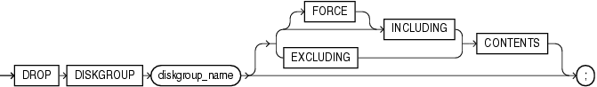

## DROP DISKGROUP

Note:

This SQL statement is valid only if you are using Oracle ASM and you have started an Oracle ASM instance. You must issue this statement from within the Oracle ASM instance, not from a normal database instance. For information on starting an Oracle ASM instance, refer to [Oracle Automatic Storage Management Administrator's Guide](https://docs.oracle.com/pls/topic/lookup?ctx=en/database/oracle/oracle-database/21/sqlrf&id=OSTMG036).

Purpose

The `DROP` `DISKGROUP` statement lets you drop an Oracle ASM disk group along with all the files in the disk group. Oracle ASM first ensures that no files in the disk group are open. It then drops the disk group and all its member disks and clears the disk header.

See Also:

- [CREATE DISKGROUP](CREATE-DISKGROUP.md) and [ALTER DISKGROUP](ALTER-DISKGROUP.md) for information on creating and modifying disk groups
- [Oracle Automatic Storage Management Administrator's Guide](https://docs.oracle.com/pls/topic/lookup?ctx=en/database/oracle/oracle-database/21/sqlrf&id=OSTMG036) for information on Oracle ASM and using disks groups to simplify database administration

Prerequisites

You must have the `SYSASM` system privilege and you must have an Oracle ASM instance started, from which you issue this statement. The disk group to be dropped must be mounted.

Syntax

drop\_diskgroup::=



> ```
> DROP DISKGROUP diskgroup_name
>    [  FORCE INCLUDING CONTENTS
>    | { INCLUDING | EXCLUDING } CONTENTS
>    ];
> ```
>
> [  
> Copyright © 1996, 2025, Oracle and/or its affiliates.](https://docs.oracle.com/en/database/oracle/oracle-database/dcommon/html/cpyr.htm)


Semantics

diskgroup\_name

Specify the name of the disk group you want to drop.

INCLUDING CONTENTS

Specify `INCLUDING` `CONTENTS` to confirm that Oracle ASM should drop all the files in the disk group. You must specify this clause if the disk group contains any files.

FORCE

This clause clears the headers on the disk belonging to a disk group that cannot be mounted by the Oracle ASM instance. The disk group cannot be mounted by any instance of the database.

The Oracle ASM instance first determines whether the disk group is being used by any other Oracle ASM instance using the same storage subsystem. If it is being used, and if the disk group is in the same cluster, or on the same node, then the statement fails. If the disk group is in a different cluster, then the system further checks to determine whether the disk group is mounted by any instance in the other cluster. If it is mounted elsewhere, then the statement fails. However, this latter check is not as definitive as the checks for disk groups in the same cluster. Therefore, use this clause with caution.

EXCLUDING CONTENTS

Specify `EXCLUDING` `CONTENTS` to ensure that Oracle ASM drops the disk group only when the disk group is empty. This is the default. If the disk group is not empty, then an error will be returned.

Examples

Dropping a Diskgroup: Example

The following statement drops the Oracle ASM disk group `dgroup_01`, which was created in " [Creating a Diskgroup: Example](CREATE-DISKGROUP.md) ", and all of the files in the disk group:

```
DROP DISKGROUP dgroup_01 INCLUDING CONTENTS;
```