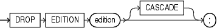

## DROP EDITION

Purpose

Use the `DROP` `EDITION` statement to drop an edition, along with all actual editionable objects it contains. An actual editionable object is an editionable object that has been created or modified in an edition.

See Also:

[CREATE EDITION](CREATE-EDITION.md) for a listing of editionable object types

Prerequisites

You must have the `DROP` `ANY` `EDITION` system privilege, granted either directly or through a role.

Syntax

drop\_edition::=



> ```
> DROP EDITION edition [CASCADE];
> ```
>
> [  
> Copyright © 1996, 2025, Oracle and/or its affiliates.](https://docs.oracle.com/en/database/oracle/oracle-database/dcommon/html/cpyr.htm)


Semantics

Objects that are not editionable, or that are editionable but have not been actualized in the current edition, are not dropped.

You must specify `CASCADE` if the specified edition contains any actual editionable objects.

This statement is subject to the following conditions and restrictions:

- The specified edition cannot have both a parent edition and a child edition.
- `DROP` `EDITION` will fail if you attempt to drop the default edition.
- `DROP` `EDITION` will fail if you attempt to drop the root edition and the recycle bin contains at least one object that used to be in that edition before it was dropped. Under these circumstances, even `DROP` `EDITION` `CASCADE` will fail. In this case, you can purge all objects from the recycle bin with the `PURGE` `DBA_RECYCLEBIN` statement and then drop the edition. Refer to [PURGE](PURGE.md) for more information.
	`DROP` `EDITION` will also fail if you attempt to drop the leaf edition and the recycle bin contains at least one object that used to be in that edition before it was dropped. However, under these circumstances, `DROP` `EDITION` `CASCADE` will succeed.
	The only type of editioned object that might be in the recycle bin is a trigger.

See Also:

- [Oracle Database Development Guide](https://docs.oracle.com/pls/topic/lookup?ctx=en/database/oracle/oracle-database/21/sqlrf&id=ADFNS-GUID-E6DBE175-2598-430F-9D0A-AB22CAE7DDDA)
- [Oracle Database PL/SQL Packages and Types Reference](https://docs.oracle.com/pls/topic/lookup?ctx=en/database/oracle/oracle-database/21/sqlrf&id=ARPLS-GUID-40AD8944-D7E0-4ACA-9A05-3DC502F47D27)

Examples

For examples that use this statement, refer to [CREATE EDITION](CREATE-EDITION.md).