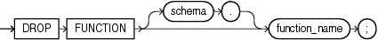

## DROP FUNCTION

Purpose

Functions are defined using PL/SQL. Refer to [Oracle Database PL/SQL Language Reference](https://docs.oracle.com/pls/topic/lookup?ctx=en/database/oracle/oracle-database/21/sqlrf&id=LNPLS99993) for complete information on creating, altering, and dropping functions.

Use the `DROP` `FUNCTION` statement to remove a standalone stored function from the database.

Note:

Do not use this statement to remove a function that is part of a package. Instead, either drop the entire package using the `DROP` `PACKAGE` statement or redefine the package without the function using the `CREATE` `PACKAGE` statement with the `OR` `REPLACE` clause.

Prerequisites

The function must be in your own schema or you must have the `DROP` `ANY` `PROCEDURE` system privilege.

Syntax

drop\_function::=



> ```
> DROP FUNCTION [ schema. ] function_name ;
> ```
>
> [  
> Copyright © 1996, 2025, Oracle and/or its affiliates.](https://docs.oracle.com/en/database/oracle/oracle-database/dcommon/html/cpyr.htm)


Semantics

schema

Specify the schema containing the function. If you omit `schema`, then Oracle Database assumes the function is in your own schema.

function\_name

Specify the name of the function to be dropped.

Oracle Database invalidates any local objects that depend on, or call, the dropped function. If you subsequently reference one of these objects, then the database tries to recompile the object and returns an error if you have not re-created the dropped function.

If any statistics types are associated with the function, then the database disassociates the statistics types with the `FORCE` option and drops any user-defined statistics collected with the statistics type.

See Also:

- [Oracle Database Concepts](https://docs.oracle.com/pls/topic/lookup?ctx=en/database/oracle/oracle-database/21/sqlrf&id=CNCPT1859) for more information on how Oracle Database maintains dependencies among schema objects, including remote objects
- [ASSOCIATE STATISTICS](ASSOCIATE-STATISTICS.md) and [DISASSOCIATE STATISTICS](DISASSOCIATE-STATISTICS.md) for more information on statistics type associations

Examples

Dropping a Function: Example

The following statement drops the function `SecondMax` in the sample schema `oe` and invalidates all objects that depend upon `SecondMax`:

```
DROP FUNCTION oe.SecondMax;
```

See Also:

[Oracle Database PL/SQL Language Reference](https://docs.oracle.com/pls/topic/lookup?ctx=en/database/oracle/oracle-database/21/sqlrf&id=LNPLS01377) for the example that creates the `SecondMax` function