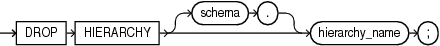

## DROP HIERARCHY

Purpose

Use the `DROP` `HIERARCHY` statement to drop a hierarchy. A `HIERARCHY` object is a component of analytic views.

Prerequisites

To drop a hierarchy in your own schema, you must have the `DROP` `HIERARCHY` system privilege. To drop a hierarchy in another user's schema, you must have the `DROP` `ANY` `HIERARCHY` system privilege.

Syntax

drop\_hierarchy::=



> ```
> DROP HIERARCHY [ schema. ] hierarchy_name;
> ```
>
> [  
> Copyright © 1996, 2025, Oracle and/or its affiliates.](https://docs.oracle.com/en/database/oracle/oracle-database/dcommon/html/cpyr.htm)


Semantics

schema

Specify the schema in which the hierarchy exists. If you do not specify a schema, then Oracle Database looks for the hierarchy in your own schema.

hierarchy\_name

Specify the name of the hierarchy to drop.

Example

The following statement drops the specified hierarchy object:

```
DROP HIERARCHY product_hier;
```