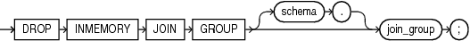

## DROP INMEMORY JOIN GROUP

Purpose

Use the `DROP` `INMEMORY` `JOIN` `GROUP` statement to remove a join group from the database.

See Also:

- [CREATE INMEMORY JOIN GROUP](CREATE-INMEMORY-JOIN-GROUP.md) and [ALTER INMEMORY JOIN GROUP](ALTER-INMEMORY-JOIN-GROUP.md)
- [Oracle Database In-Memory Guide](https://docs.oracle.com/pls/topic/lookup?ctx=en/database/oracle/oracle-database/21/sqlrf&id=INMEM-GUID-3E5491C4-B345-4A8E-8B1B-8DC150C8A797) for more information on join groups

Prerequisites

If the join group is in another user’s schema, then you must have the `DROP` `ANY` `TABLE` system privilege.

Syntax

drop\_inmemory\_join\_group::=



> ```
> DROP INMEMORY JOIN GROUP [ schema. ] join_group ;
> ```
>
> [  
> Copyright © 1996, 2025, Oracle and/or its affiliates.](https://docs.oracle.com/en/database/oracle/oracle-database/dcommon/html/cpyr.htm)


Semantics

schema

Specify the schema containing the join group. If you omit `schema`, then the database assumes the join group is in your own schema.

join\_group

Specify the name of the join group to be dropped.

You can view existing join groups by querying the `DBA_JOINGROUPS` or `USER_JOINGROUPS` data dictionary view. Refer to [Oracle Database Reference](https://docs.oracle.com/pls/topic/lookup?ctx=en/database/oracle/oracle-database/21/sqlrf&id=REFRN-GUID-285814BC-3BE0-47DA-8832-779229D5A93A) for more information on these views.

Examples

The following statement drops the join group `prod_id1`:

```
DROP INMEMORY JOIN GROUP prod_id1;
```