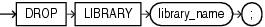

## DROP LIBRARY

Purpose

Use the `DROP` `LIBRARY` statement to remove an external procedure library from the database.

Prerequisites

You must have the `DROP` `ANY` `LIBRARY` system privilege.

Syntax

drop\_library::=



> ```
> DROP LIBRARY library_name ;
> ```
>
> [  
> Copyright © 1996, 2025, Oracle and/or its affiliates.](https://docs.oracle.com/en/database/oracle/oracle-database/dcommon/html/cpyr.htm)


Semantics

library\_name

Specify the name of the external procedure library being dropped.

Examples

Dropping a Library: Example

The following statement drops the `ext_lib` library:

```
DROP LIBRARY ext_lib;
```