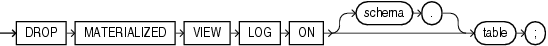

## DROP MATERIALIZED VIEW LOG

Purpose

Use the `DROP` `MATERIALIZED` `VIEW` `LOG` statement to remove a materialized view log from the database.

Note:

The keyword `SNAPSHOT` is supported in place of `MATERIALIZED` `VIEW` for backward compatibility.

See Also:

- [CREATE MATERIALIZED VIEW](CREATE-MATERIALIZED-VIEW.md) and [ALTER MATERIALIZED VIEW](ALTER-MATERIALIZED-VIEW.md) for more information on materialized views
- [CREATE MATERIALIZED VIEW LOG](CREATE-MATERIALIZED-VIEW-LOG.md) for information on materialized view logs
- [Oracle Database Administrator’s Guide](https://docs.oracle.com/pls/topic/lookup?ctx=en/database/oracle/oracle-database/21/sqlrf&id=REPLN-GUID-A422B474-4BED-4A60-AEDB-E93630746083) for information on materialized views in a replication environment
- [Oracle Database Data Warehousing Guide](https://docs.oracle.com/pls/topic/lookup?ctx=en/database/oracle/oracle-database/21/sqlrf&id=DWHSG008) for information on materialized views in a data warehousing environment

Prerequisites

To drop a materialized view log, you must have the privileges needed to drop a table.

See Also:

[DROP TABLE](DROP-TABLE.md)

Syntax

drop\_materialized\_view\_log::=



> ```
> DROP MATERIALIZED VIEW LOG ON [ schema. ] table ;
> ```
>
> [  
> Copyright © 1996, 2025, Oracle and/or its affiliates.](https://docs.oracle.com/en/database/oracle/oracle-database/dcommon/html/cpyr.htm)


Semantics

schema

Specify the schema containing the materialized view log and its master table. If you omit `schema`, then Oracle Database assumes the materialized view log and master table are in your own schema.

table

Specify the name of the master table associated with the materialized view log to be dropped.

After you drop a materialized view log that was created `FOR` `FAST` `REFRESH`, some materialized views based on the materialized view log master table can no longer be fast refreshed. These materialized views include rowid materialized views, primary key materialized views, and subquery materialized views.

See Also:

[Oracle Database Data Warehousing Guide](https://docs.oracle.com/pls/topic/lookup?ctx=en/database/oracle/oracle-database/21/sqlrf&id=DWHSG008) for a description of these types of materialized views

After you drop a materialized view log that was created `FOR` `SYNCHRONOUS` `REFRESH` (a staging log), the materialized views based on the staging log master table can no longer be synchronous refreshed.

Examples

Dropping a Materialized View Log: Example

The following statement drops the materialized view log on the `oe.customers` master table:

```
DROP MATERIALIZED VIEW LOG ON customers;
```