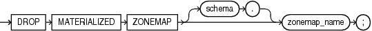

## DROP MATERIALIZED ZONEMAP

Purpose

Use the `DROP` `MATERIALIZED` `ZONEMAP` statement to remove an existing zone map from the database.

Prerequisites

The zone map must be in your own schema or you must have the `DROP` `ANY` `MATERIALIZED` `VIEW` system privilege. You must also have the privileges to drop the internal table and indexes that the database uses to maintain the zone map data.

See Also:

[DROP TABLE](DROP-TABLE.md) and [DROP INDEX](DROP-INDEX.md) for information on privileges required to drop objects that the database uses to maintain the zone map

Syntax

drop\_materialized\_zonemap::=



> ```
> DROP MATERIALIZED ZONEMAP [ schema. ] zonemap_name ;
> ```
>
> [  
> Copyright © 1996, 2025, Oracle and/or its affiliates.](https://docs.oracle.com/en/database/oracle/oracle-database/dcommon/html/cpyr.htm)


Semantics

schema

Specify the schema containing the zone map. If you omit `schema`, then Oracle Database assumes the zone map is in your own schema.

zonemap\_name

Specify the name of the existing zone map to be dropped.

Example

Dropping a Zone Map: Examples

The following statement drops the zone map `sales_zmap`:

```
DROP MATERIALIZED ZONEMAP sales_zmap;
```