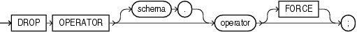

## DROP OPERATOR

Purpose

Use the `DROP` `OPERATOR` statement to drop a user-defined operator.

See Also:

- [CREATE OPERATOR](CREATE-OPERATOR.md) and [ALTER OPERATOR](ALTER-OPERATOR.md) for information on creating and modifying operators
- " [User-Defined Operators](User-Defined-Operators.md) " and [Oracle Database Data Cartridge Developer's Guide](https://docs.oracle.com/pls/topic/lookup?ctx=en/database/oracle/oracle-database/21/sqlrf&id=ADDCI2100) for more information on operators in general
- [ALTER INDEXTYPE](ALTER-INDEXTYPE.md) for information on dropping an operator of a user-defined indextype

Prerequisites

The operator must be in your schema or you must have the `DROP` `ANY` `OPERATOR` system privilege.

Syntax

drop\_operator::=



> ```
> DROP OPERATOR [ schema. ] operator [ FORCE ] ;
> ```
>
> [  
> Copyright © 1996, 2025, Oracle and/or its affiliates.](https://docs.oracle.com/en/database/oracle/oracle-database/dcommon/html/cpyr.htm)


Semantics

schema

Specify the schema containing the operator. If you omit `schema`, then Oracle Database assumes the operator is in your own schema.

operator

Specify the name of the operator to be dropped.

FORCE

Specify `FORCE` to drop the operator even if it is currently being referenced by one or more schema objects, such as indextypes, packages, functions, procedures, and so on. The database marks any such dependent objects `INVALID`. Without `FORCE`, you cannot drop an operator if any schema objects reference it.

Examples

Dropping a User-Defined Operator: Example

The following statement drops the operator `eq_op`:

```
DROP OPERATOR eq_op;
```

Because the `FORCE` clause is not specified, this operation will fail if any of the bindings of this operator are referenced by an indextype.