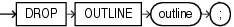

## DROP OUTLINE

Purpose

Note:

- Stored outlines are deprecated. They are still supported for backward compatibility. However, Oracle recommends that you use SQL plan management instead. SQL plan management creates SQL plan baselines, which offer superior SQL performance stability compared with stored outlines.
- You can migrate existing stored outlines to SQL plan baselines by using the `MIGRATE_STORED_OUTLINE` function of the `DBMS_SPM` package or Enterprise Manager Cloud Control. When the migration is complete, the stored outlines are marked as migrated and can be removed. You can drop all migrated stored outlines on your system by using the `DROP_MIGRATED_STORED_OUTLINE` function of the `DBMS_SPM` package.
- See Also: [Oracle Database SQL Tuning Guide](https://docs.oracle.com/pls/topic/lookup?ctx=en/database/oracle/oracle-database/21/sqlrf&id=TGSQL615) for more information about SQL plan management and [Oracle Database PL/SQL Packages and Types Reference](https://docs.oracle.com/pls/topic/lookup?ctx=en/database/oracle/oracle-database/21/sqlrf&id=ARPLS150) for information about the `DBMS_SPM` package

Use the `DROP` `OUTLINE` statement to drop a stored outline.

See Also:

[CREATE OUTLINE](CREATE-OUTLINE.md) for information on creating an outline

Prerequisites

To drop an outline, you must have the `DROP` `ANY` `OUTLINE` system privilege.

Syntax

drop\_outline::=



> ```
> DROP OUTLINE outline ;
> ```
>
> [  
> Copyright © 1996, 2025, Oracle and/or its affiliates.](https://docs.oracle.com/en/database/oracle/oracle-database/dcommon/html/cpyr.htm)


Semantics

outline

Specify the name of the outline to be dropped.

After the outline is dropped, if the SQL statement for which the stored outline was created is compiled, then the optimizer generates a new execution plan without the influence of the outline.

Examples

Dropping an Outline: Example

The following statement drops the stored outline called `salaries`.

```
DROP OUTLINE salaries;
```