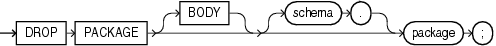

## DROP PACKAGE

Purpose

Packages are defined using PL/SQL. Refer to [Oracle Database PL/SQL Language Reference](https://docs.oracle.com/pls/topic/lookup?ctx=en/database/oracle/oracle-database/21/sqlrf&id=LNPLS99992) for complete information on creating, altering, and dropping packages.

Use the `DROP` `PACKAGE` statement to remove a stored package from the database. This statement drops the body and specification of a package.

Note:

Do not use this statement to remove a single object from a package. Instead, re-create the package without the object using the `CREATE` `PACKAGE` and `CREATE` `PACKAGE` `BODY` statements with the `OR` `REPLACE` clause.

Prerequisites

The package must be in your own schema or you must have the `DROP` `ANY` `PROCEDURE` system privilege.

Syntax

drop\_package::=



> ```
> DROP PACKAGE [ BODY ] [ schema. ] package ;
> ```
>
> [  
> Copyright © 1996, 2025, Oracle and/or its affiliates.](https://docs.oracle.com/en/database/oracle/oracle-database/dcommon/html/cpyr.htm)


Semantics

BODY

Specify `BODY` to drop only the body of the package. If you omit this clause, then Oracle Database drops both the body and specification of the package.

When you drop only the body of a package but not its specification, the database does not invalidate dependent objects. However, you cannot call one of the procedures or stored functions declared in the package specification until you re-create the package body.

schema

Specify the schema containing the package. If you omit `schema`, then the database assumes the package is in your own schema.

package

Specify the name of the package to be dropped.

Oracle Database invalidates any local objects that depend on the package specification. If you subsequently reference one of these objects, then the database tries to recompile the object and returns an error if you have not re-created the dropped package.

If any statistics types are associated with the package, then the database disassociates the statistics types with the `FORCE` clause and drops any user-defined statistics collected with the statistics types.

See Also:

[ASSOCIATE STATISTICS](ASSOCIATE-STATISTICS.md) and [DISASSOCIATE STATISTICS](DISASSOCIATE-STATISTICS.md)

Examples

Dropping a Package: Example

The following statement drops the specification and body of the `emp_mgmt` package, invalidating all objects that depend on the specification. See [Oracle Database PL/SQL Language Reference](https://docs.oracle.com/pls/topic/lookup?ctx=en/database/oracle/oracle-database/21/sqlrf&id=LNPLS01381) for the example that creates this package.

```
DROP PACKAGE emp_mgmt;
```