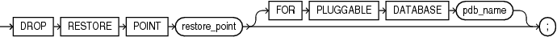

## DROP RESTORE POINT

Purpose

Use the `DROP` `RESTORE` `POINT` statement to remove a normal restore point or a guaranteed restore point from the database.

- You need not drop normal restore points. The database automatically drops the oldest restore points when necessary, as described in the semantics for [restore\_point](CREATE-RESTORE-POINT.md). However, you can drop a normal restore point if you want to reuse the name.
- Guaranteed restore points are not dropped automatically. Therefore, if you want to remove a guaranteed restore point from the database, then you must do so explicitly using this statement.

See Also:

[CREATE RESTORE POINT](CREATE-RESTORE-POINT.md), [FLASHBACK DATABASE](FLASHBACK-DATABASE.md), and [FLASHBACK TABLE](FLASHBACK-TABLE.md) for information on creating and using restore points

Prerequisites

To drop a normal restore point, you must have the `SELECT` `ANY` `DICTIONARY`, `FLASHBACK` `ANY` `TABLE`, `SYSBACKUP`, or `SYSDG` system privilege.

To drop a guaranteed restore point, you must fulfill one of the following conditions:

- You must connect `AS SYSDBA`, or `AS SYSBACKUP`, or `AS SYSDG`.
- You must have been granted the `SYSDBA` privilege, and be using a multitenant database.
- You must be running as user `SYS`, and be using a a multitenant database.

You can drop a restore point when connected to a multitenant container database (CDB) as follows:

- To drop a normal CDB restore point, the current container must be the root and you must have the `SELECT` `ANY` `DICTIONARY` or `FLASHBACK` `ANY` `TABLE` system privilege, either granted commonly or granted locally in the root, or the `SYSDBA`, `SYSBACKUP`, or `SYSDG` system privilege granted commonly.
- To drop a guaranteed CDB restore point, the current container must be the root and you must have the `SYSDBA`, `SYSBACKUP`, or `SYSDG` system privilege granted commonly.
- To drop a normal PDB restore point, the current container must be the root and you must have the `SELECT` `ANY` `DICTIONARY`, `FLASHBACK` `ANY` `TABLE`, `SYSDBA`, `SYSBACKUP`, or `SYSDG` system privilege, granted commonly, or the current container must be the PDB in which you want to create the restore point and you must have the `SELECT` `ANY` `DICTIONARY`, `FLASHBACK` `ANY` `TABLE`, `SYSDBA`, `SYSBACKUP`, or `SYSDG` system privilege, granted commonly or granted locally in that PDB.
- To drop a guaranteed PDB restore point, the current container must be the root and you must have the `SYSDBA`, `SYSBACKUP`, or `SYSDG` system privilege, granted commonly, or the current container must be the PDB in which you want to create the restore point and you must have the `SYSDBA`, `SYSBACKUP`, or `SYSDG` system privilege, granted commonly or granted locally in that PDB.

Syntax

drop\_restore\_point::=



> ```
> DROP RESTORE POINT restore_point [ FOR PLUGGABLE DATABASE pdb_name ] ;
> ```
>
> [  
> Copyright © 1996, 2025, Oracle and/or its affiliates.](https://docs.oracle.com/en/database/oracle/oracle-database/dcommon/html/cpyr.htm)


Semantics

restore\_point

Specify the name of the restore point you want to drop.

FOR PLUGGABLE DATABASE

This clause enables you to drop a PDB restore point when you are connected to the root. For `pdb_name`, specify the name of the PDB that contains the restore point you want to drop.

If you are connected to the PDB from which you want to drop the restore point, then it is not necessary to specify this clause. However, if you specify this clause, then you must specify the name of the PDB to which you are connected.

Examples

Dropping a Restore Point: Example

The following example drops the `good_data` restore point, which was created in " [Creating and Using a Restore Point: Example](CREATE-RESTORE-POINT.md) ":

```
DROP RESTORE POINT good_data;
```