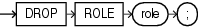

## DROP ROLE

Purpose

Use the `DROP` `ROLE` statement to remove a role from the database. When you drop a role, Oracle Database revokes it from all users and roles to whom it has been granted and removes it from the database. User sessions in which the role is already enabled are not affected. However, no new user session can enable the role after it is dropped.

See Also:

- [CREATE ROLE](CREATE-ROLE.md) and [ALTER ROLE](ALTER-ROLE.md) for information on creating roles and changing the authorization needed to enable a role
- [SET ROLE](SET-ROLE.md) for information on disabling roles for the current session

Prerequisites

You must have been granted the role with the `ADMIN` `OPTION` or you must have the `DROP` `ANY` `ROLE` system privilege.

Syntax

drop\_role::=



> ```
> DROP ROLE role ;
> ```
>
> [  
> Copyright © 1996, 2025, Oracle and/or its affiliates.](https://docs.oracle.com/en/database/oracle/oracle-database/dcommon/html/cpyr.htm)


Semantics

role

Specify the name of the role to be dropped.

Examples

Dropping a Role: Example

To drop the role `dw_manager`, which was created in " [Creating a Role: Example](CREATE-ROLE.md) ", issue the following statement:

```
DROP ROLE dw_manager;
```