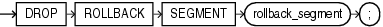

## DROP ROLLBACK SEGMENT

Purpose

Use the `DROP` `ROLLBACK` `SEGMENT` to remove a rollback segment from the database. When you drop a rollback segment, all space allocated to the rollback segment returns to the tablespace.

Note:

If your database is running in automatic undo mode, then this is the only valid operation on rollback segments. In that mode, you cannot create or alter a rollback segment.

Prerequisites

You must have the `DROP` `ROLLBACK` `SEGMENT` system privilege, and the rollback segment must be offline.

Syntax

drop\_rollback\_segment::=



> ```
> DROP ROLLBACK SEGMENT rollback_segment ;
> ```
>
> [  
> Copyright © 1996, 2025, Oracle and/or its affiliates.](https://docs.oracle.com/en/database/oracle/oracle-database/dcommon/html/cpyr.htm)


Semantics

rollback\_segment

Specify the name the rollback segment to be dropped.

Restrictions on Dropping Rollback Segments

This statement is subject to the following restrictions:

- You can drop a rollback segment only if it is offline. To determine whether a rollback segment is offline, query the data dictionary view `DBA_ROLLBACK_SEGS`. Offline rollback segments have the value `AVAILABLE` in the `STATUS` column. You can take a rollback segment offline with the `OFFLINE` clause of the `ALTER` `ROLLBACK` `SEGMENT` statement.
- You cannot drop the `SYSTEM` rollback segment.

Examples

Dropping a Rollback Segment: Example

The following syntax drops the rollback segment created in " [Creating a Rollback Segment: Example](CREATE-ROLLBACK-SEGMENT.md) ":

```
DROP ROLLBACK SEGMENT rbs_one;
```