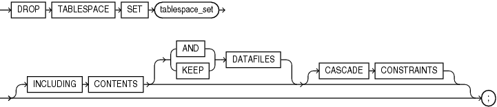

## DROP TABLESPACE SET

Note:

This SQL statement is valid only if you are using Oracle Sharding. For more information on Oracle Sharding, refer to [Oracle Database Administrator’s Guide](https://docs.oracle.com/pls/topic/lookup?ctx=en/database/oracle/oracle-database/21/sqlrf&id=ADMIN-GUID-DE8AF949-9F68-4C0C-9B5A-45401EF3C3D1).

Purpose

Use the `DROP` `TABLESPACE` `SET` statement to drop a tablespace set from a shardgroup.

When you drop a tablespace set, Oracle Database does not place it in the recycle bin. Therefore, you cannot subsequently either purge or undrop the tablespace set.

See Also:

[CREATE TABLESPACE SET](CREATE-TABLESPACE-SET.md) and [ALTER TABLESPACE SET](ALTER-TABLESPACE-SET.md)

Prerequisites

You must be connected to a shard catalog database as an SDB user.

You must have the `DROP` `TABLESPACE` system privilege. You cannot drop a tablespace set if its tablespaces contain any rollback segments holding active transactions.

Syntax

drop\_tablespace\_set::=



> ```
> DROP TABLESPACE SET tablespace_set
>    [ { DROP | KEEP } QUOTA ]
>    [ INCLUDING CONTENTS [ { AND | KEEP } DATAFILES ] [ CASCADE CONSTRAINTS ] ]
>    ;
> ```
>
> [  
> Copyright © 1996, 2025, Oracle and/or its affiliates.](https://docs.oracle.com/en/database/oracle/oracle-database/dcommon/html/cpyr.htm)


Semantics

tablespace\_set

Specify the name of the tablespace set to be dropped.

INCLUDING CONTENTS

This clause lets you specify how the database manages objects and datafiles associated with the tablespaces in the tablespace set during the drop operation. The `INCLUDING` `CONTENTS` clause has the same semantics here as for the `DROP` `TABLESPACE` statement. See [INCLUDING CONTENTS](DROP-TABLESPACE.md) for the full semantics of this clause.

Examples

Dropping a Tablespace Set: Example

The following statement drops the tablespace set `ts1`:

```
DROP TABLESPACE SET ts1;
```