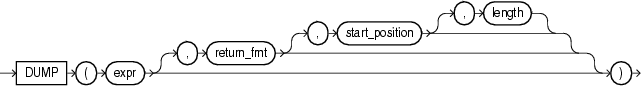

## DUMP

Syntax



> ```
> DUMP(expr[, return_fmt [, start_position [, length ] ] ])
> ```
>
> [  
> Copyright © 1996, 2025, Oracle and/or its affiliates.](https://docs.oracle.com/en/database/oracle/oracle-database/dcommon/html/cpyr.htm)


Purpose

`DUMP` returns a `VARCHAR2` value containing the data type code, length in bytes, and internal representation of `expr`. The returned result is always in the database character set. For the data type corresponding to each code, see [Table 2-1](Data-Types.md).

The argument `return_fmt` specifies the format of the return value and can have any of the following values:

- 8 returns result in octal notation.
- 10 returns result in decimal notation.
- 16 returns result in hexadecimal notation.
- 17 returns each byte printed as a character if and only if it can be interpreted as a printable character in the character set of the compiler—typically ASCII or EBCDIC. Some ASCII control characters may be printed in the form ^X as well. Otherwise the character is printed in hexadecimal notation. All NLS parameters are ignored. Do not depend on any particular output format for `DUMP` with `return_fmt` 17.

By default, the return value contains no character set information. To retrieve the character set name of `expr`, add 1000 to any of the preceding format values. For example, a `return_fmt` of 1008 returns the result in octal and provides the character set name of `expr`.

The arguments `start_position` and `length` combine to determine which portion of the internal representation to return. The default is to return the entire internal representation in decimal notation.

If `expr` is null, then this function returns `NULL`.

This function does not support `CLOB` data directly. However, `CLOB` s can be passed in as arguments through implicit data conversion.

See Also:

- [Data Type Comparison Rules](Data-Type-Comparison-Rules.md) for more information
- Appendix C in [Oracle Database Globalization Support Guide](https://docs.oracle.com/pls/topic/lookup?ctx=en/database/oracle/oracle-database/21/sqlrf&id=NLSPG-GUID-AFCE41ED-775B-4A00-AF38-C436776AE0C5) for the collation derivation rules, which define the collation assigned to the character return value of `DUMP`

Examples

The following examples show how to extract dump information from a string expression and a column:

```
SELECT DUMP('abc', 1016)
  FROM DUAL;

DUMP('ABC',1016)                          
------------------------------------------ 
Typ=96 Len=3 CharacterSet=WE8DEC: 61,62,63 

SELECT DUMP(last_name, 8, 3, 2) "OCTAL"
  FROM employees
  WHERE last_name = 'Hunold'
  ORDER BY employee_id;

OCTAL
-------------------------------------------------------------------
Typ=1 Len=6: 156,157

SELECT DUMP(last_name, 10, 3, 2) "ASCII"
  FROM employees
  WHERE last_name = 'Hunold'
  ORDER BY employee_id;

ASCII
--------------------------------------------------------------------
Typ=1 Len=6: 110,111
```