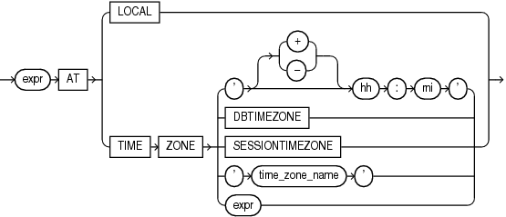

## Datetime Expressions

A datetime expression yields a value of one of the datetime data types.

datetime\_expression::=



> ```
> expr AT
>    { LOCAL
>    | TIME ZONE { ' [ + | - ] hh:mi'
>                | DBTIMEZONE
>                | 'time_zone_name'
>                | expr
>                }
>    }
> ```
>
> [  
> Copyright © 1996, 2025, Oracle and/or its affiliates.](https://docs.oracle.com/en/database/oracle/oracle-database/dcommon/html/cpyr.htm)


The initial `expr` is any expression, except a scalar subquery expression, that evaluates to a value of data type `TIMESTAMP`, `TIMESTAMP` `WITH` `TIME` `ZONE`, or `TIMESTAMP` `WITH` `LOCAL` `TIME` `ZONE`. The `DATE` data type is not supported. If this `expr` is itself a `datetime_expression`, then it must be enclosed in parentheses.

Datetimes and intervals can be combined according to the rules defined in [Table 2-5](Data-Types.md). The three combinations that yield datetime values are valid in a datetime expression.

If you specify `AT` `LOCAL`, then Oracle uses the current session time zone.

The settings for `AT` `TIME` `ZONE` are interpreted as follows:

- The string `'` `[``+` `|` `-``]` `hh`:`mi` ' specifies a time zone as an offset from UTC. For `hh`, specify the number of hours. For `mi`, specify the number of minutes.
- `DBTIMEZONE`: Oracle uses the database time zone established (explicitly or by default) during database creation.
- `SESSIONTIMEZONE`: Oracle uses the session time zone established by default or in the most recent `ALTER` `SESSION` statement.
- `time_zone_name`: Oracle returns the `datetime_value_expr` in the time zone indicated by `time_zone_name`. For a listing of valid time zone region names, query the `V$TIMEZONE_NAMES` dynamic performance view.
	Note:
	Time zone region names are needed by the daylight saving feature. These names are stored in two types of time zone files: one large and one small. One of these files is the default file, depending on your environment and the release of Oracle Database you are using. For more information regarding time zone files and names, see [Oracle Database Globalization Support Guide](https://docs.oracle.com/pls/topic/lookup?ctx=en/database/oracle/oracle-database/21/sqlrf&id=NLSPG014).

See Also:

- [Oracle Database Globalization Support Guide](https://docs.oracle.com/pls/topic/lookup?ctx=en/database/oracle/oracle-database/21/sqlrf&id=NLSPG0141) for a complete listing of the time zone region names in both files
- [Oracle Database Reference](https://docs.oracle.com/pls/topic/lookup?ctx=en/database/oracle/oracle-database/21/sqlrf&id=REFRN003) for information on the dynamic performance views

- `expr`: If `expr` returns a character string with a valid time zone format, then Oracle returns the input in that time zone. Otherwise, Oracle returns an error.

Example

The following example converts the datetime value of one time zone to another time zone:

```
SELECT FROM_TZ(CAST(TO_DATE('1999-12-01 11:00:00', 
      'YYYY-MM-DD HH:MI:SS') AS TIMESTAMP), 'America/New_York') 
   AT TIME ZONE 'America/Los_Angeles' "West Coast Time" 
   FROM DUAL;

West Coast Time
------------------------------------------------
01-DEC-99 08.00.00.000000 AM AMERICA/LOS_ANGELES
```