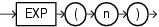

## EXP

Syntax



> ```
> EXP(n)
> ```
>
> [  
> Copyright © 1996, 2025, Oracle and/or its affiliates.](https://docs.oracle.com/en/database/oracle/oracle-database/dcommon/html/cpyr.htm)


Purpose

`EXP` returns `e` raised to the `n` th power, where `e` = 2.71828183.... The function returns a value of the same type as the argument.

This function takes as an argument any numeric data type or any nonnumeric data type that can be implicitly converted to a numeric data type. If the argument is `BINARY_FLOAT`, then the function returns `BINARY_DOUBLE`. Otherwise the function returns the same numeric data type as the argument.

Examples

The following example returns `e` to the 4th power:

```
SELECT EXP(4) "e to the 4th power"
  FROM DUAL;

e to the 4th power
------------------
          54.59815
```