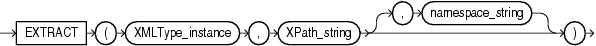

## EXTRACT (XML)

Note:

The `EXTRACT` (XML) function is deprecated. It is still supported for backward compatibility. However, Oracle recommends that you use the `XMLQUERY` function instead. See [XMLQUERY](XMLQUERY.md) for more information.

Syntax

extract\_xml::=



> ```
> EXTRACT(XMLType_instance, XPath_string [, namespace_string ])
> ```
>
> [  
> Copyright © 1996, 2025, Oracle and/or its affiliates.](https://docs.oracle.com/en/database/oracle/oracle-database/dcommon/html/cpyr.htm)


Purpose

`EXTRACT` (XML) is similar to the `EXISTSNODE` function. It applies a `VARCHAR2` XPath string and returns an `XMLType` instance containing an XML fragment. You can specify an absolute `XPath_string` with an initial slash or a relative `XPath_string` by omitting the initial slash. If you omit the initial slash, then the context of the relative path defaults to the root node. The optional `namespace_string` is required if the XML you are handling uses a namespace prefix. This argument must resolve to a `VARCHAR2` value that specifies a default mapping or namespace mapping for prefixes, which Oracle Database uses when evaluating the XPath expression(s).

Examples

The following example extracts the value of the `/Warehouse/Dock` node of the XML path of the `warehouse_spec` column in the sample table `oe.warehouses`:

```
SELECT warehouse_name,
       EXTRACT(warehouse_spec, '/Warehouse/Docks') "Number of Docks"
  FROM warehouses
  WHERE warehouse_spec IS NOT NULL
  ORDER BY warehouse_name;

WAREHOUSE_NAME            Number of Docks
------------------------- -------------------------
New Jersey
San Francisco             <Docks>1</Docks>
Seattle, Washington       <Docks>3</Docks>
Southlake, Texas          <Docks>2</Docks>
```

Compare this example with the example for [EXTRACTVALUE](EXTRACTVALUE.md), which returns the scalar value of the XML fragment.