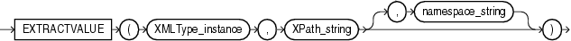

## EXTRACTVALUE

Note:

The `EXTRACTVALUE` function is deprecated. It is still supported for backward compatibility. However, Oracle recommends that you use the `XMLTABLE` function, or the `XMLCAST` and `XMLQUERY` functions instead. See [XMLTABLE](XMLTABLE.md), [XMLCAST](XMLCAST.md), and [XMLQUERY](XMLQUERY.md) for more information.

Syntax



> ```
> EXTRACTVALUE(XMLType_instance, XPath_string [, namespace_string ])
> ```
>
> [  
> Copyright © 1996, 2025, Oracle and/or its affiliates.](https://docs.oracle.com/en/database/oracle/oracle-database/dcommon/html/cpyr.htm)


The `EXTRACTVALUE` function takes as arguments an `XMLType` instance and an XPath expression and returns a scalar value of the resultant node. The result must be a single node and be either a text node, attribute, or element. If the result is an element, then the element must have a single text node as its child, and it is this value that the function returns. You can specify an absolute `XPath_string` with an initial slash or a relative `XPath_string` by omitting the initial slash. If you omit the initial slash, the context of the relative path defaults to the root node.

If the specified XPath points to a node with more than one child, or if the node pointed to has a non-text node child, then Oracle returns an error. The optional `namespace_string` must resolve to a `VARCHAR2` value that specifies a default mapping or namespace mapping for prefixes, which Oracle uses when evaluating the XPath expression(s).

For documents based on XML schemas, if Oracle can infer the type of the return value, then a scalar value of the appropriate type is returned. Otherwise, the result is of type `VARCHAR2`. For documents that are not based on XML schemas, the return type is always `VARCHAR2`.

See Also:

Appendix C in [Oracle Database Globalization Support Guide](https://docs.oracle.com/pls/topic/lookup?ctx=en/database/oracle/oracle-database/21/sqlrf&id=NLSPG-GUID-AFCE41ED-775B-4A00-AF38-C436776AE0C5) for the collation derivation rules, which define the collation assigned to the character return value of `EXTRACTVALUE`

Examples

The following example takes as input the same arguments as the example for [EXTRACT (XML)](EXTRACT-XML.md). Instead of returning an XML fragment, as does the `EXTRACT` function, it returns the scalar value of the XML fragment:

```
SELECT warehouse_name, EXTRACTVALUE(e.warehouse_spec, '/Warehouse/Docks') "Docks"
  FROM warehouses e 
  WHERE warehouse_spec IS NOT NULL
  ORDER BY warehouse_name;

WAREHOUSE_NAME       Docks
-------------------- ------------
New Jersey
San Francisco        1
Seattle, Washington  3
Southlake, Texas     2
```