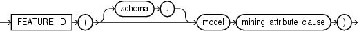
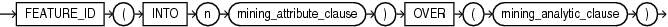

## FEATURE\_ID

Syntax

feature\_id::=



> ```
> FEATURE_ID( [ schema . ] model mining_attribute_clause )
> ```
>
> [  
> Copyright © 1996, 2025, Oracle and/or its affiliates.](https://docs.oracle.com/en/database/oracle/oracle-database/dcommon/html/cpyr.htm)


Analytic Syntax

feature\_id\_analytic::=



> ```
> FEATURE_ID ( INTO n mining_attribute_clause )
>            OVER ( mining_analytic_clause )
> ```
>
> [  
> Copyright © 1996, 2025, Oracle and/or its affiliates.](https://docs.oracle.com/en/database/oracle/oracle-database/dcommon/html/cpyr.htm)


mining\_attribute\_clause::=


> ```
> USING
> { * 
> | { [ schema . ] table . * 
>   | expr [ AS alias ]
>   }
>     [, { [ schema . ] table . * 
>        | expr [ AS alias ]
>        }
>     ]...
> }
> ```
>
> [  
> Copyright © 1996, 2025, Oracle and/or its affiliates.](https://docs.oracle.com/en/database/oracle/oracle-database/dcommon/html/cpyr.htm)


mining\_analytic\_clause::=


> ```
> [ query_partition_clause ] [ order_by_clause ]
> ```
>
> [  
> Copyright © 1996, 2025, Oracle and/or its affiliates.](https://docs.oracle.com/en/database/oracle/oracle-database/dcommon/html/cpyr.htm)


See Also:

" [Analytic Functions](Analytic-Functions.md) " for information on the syntax, semantics, and restrictions of `mining_analytic_clause`

Purpose

`FEATURE_ID` returns the identifier of the highest value feature for each row in the selection. The feature identifier is returned as an Oracle `NUMBER`.

Syntax Choice

`FEATURE_ID` can score the data in one of two ways: It can apply a mining model object to the data, or it can dynamically mine the data by executing an analytic clause that builds and applies one or more transient mining models. Choose Syntax or Analytic Syntax:

- Syntax — Use the first syntax to score the data with a pre-defined model. Supply the name of a feature extraction model.
- Analytic Syntax — Use the analytic syntax to score the data without a pre-defined model. Include `INTO` `n`, where `n` is the number of features to extract, and `mining_analytic_clause`, which specifies if the data should be partitioned for multiple model builds. The `mining_analytic_clause` supports a `query_partition_clause` and an `order_by_clause`. (See " [analytic\_clause::=](Analytic-Functions.md) ".)

The syntax of the `FEATURE_ID` function can use an optional `GROUPING` hint when scoring a partitioned model. See [GROUPING Hint](Comments.md).

mining\_attribute\_clause

`mining_attribute_clause` identifies the column attributes to use as predictors for scoring. When the function is invoked with the analytic syntax, these predictors are also used for building the transient models. The `mining_attribute_clause` behaves as described for the `PREDICTION` function. (See " [mining\_attribute\_clause::=](PREDICTION.md) ".)

See Also:

- [Oracle Machine Learning for SQL User’s Guide](https://docs.oracle.com/pls/topic/lookup?ctx=en/database/oracle/oracle-database/21/sqlrf&id=DMPRG004) for information about scoring.
- [Oracle Machine Learning for SQL Concepts](https://docs.oracle.com/pls/topic/lookup?ctx=en/database/oracle/oracle-database/21/sqlrf&id=DMCON010) for information about feature extraction.

Note:

The following example is excerpted from the Oracle Machine Learning for SQL sample programs. For more information about the sample programs, see Appendix A in [Oracle Machine Learning for SQL User’s Guide](https://docs.oracle.com/pls/topic/lookup?ctx=en/database/oracle/oracle-database/21/sqlrf&id=DMPRG714).

Example

This example lists the features and corresponding count of customers in a data set.

```
SELECT FEATURE_ID(nmf_sh_sample USING *) AS feat, COUNT(*) AS cnt
  FROM nmf_sh_sample_apply_prepared
  GROUP BY FEATURE_ID(nmf_sh_sample USING *)
  ORDER BY cnt DESC, feat DESC;

      FEAT        CNT
---------- ----------
         7       1443
         2         49
         3          6
         6          1
         1          1
```