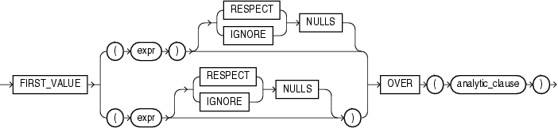

## FIRST\_VALUE

Syntax



> ```
> FIRST_VALUE 
>   { (expr) [ {RESPECT | IGNORE} NULLS ]
>   | (expr [ {RESPECT | IGNORE} NULLS ])
>   }
>   OVER (analytic_clause)
> ```
>
> [  
> Copyright © 1996, 2025, Oracle and/or its affiliates.](https://docs.oracle.com/en/database/oracle/oracle-database/dcommon/html/cpyr.htm)


See Also:

" [Analytic Functions](Analytic-Functions.md) " for information on syntax, semantics, and restrictions, including valid forms of `expr`

Purpose

`FIRST_VALUE` is an analytic function. It returns the first value in an ordered set of values. If the first value in the set is null, then the function returns `NULL` unless you specify `IGNORE NULLS`. This setting is useful for data densification.

Note:

The two forms of this syntax have the same behavior. The top branch is the ANSI format, which Oracle recommends for ANSI compatibility.

{ `RESPECT` | `IGNORE` } `NULLS` determines whether null values of `expr` are included in or eliminated from the calculation. The default is `RESPECT` `NULLS`. If you specify `IGNORE NULLS`, then `FIRST_VALUE` returns the first non-null value in the set, or `NULL` if all values are null. Refer to " [Using Partitioned Outer Joins: Examples](SELECT.md) " for an example of data densification.

You cannot nest analytic functions by using `FIRST_VALUE` or any other analytic function for `expr`. However, you can use other built-in function expressions for `expr`. Refer to " [About SQL Expressions](About-SQL-Expressions.md) " for information on valid forms of `expr`.

See Also:

Appendix C in [Oracle Database Globalization Support Guide](https://docs.oracle.com/pls/topic/lookup?ctx=en/database/oracle/oracle-database/21/sqlrf&id=NLSPG-GUID-AFCE41ED-775B-4A00-AF38-C436776AE0C5) for the collation derivation rules, which define the collation assigned to the return value of `FIRST_VALUE` when it is a character value

Examples

The following example selects, for each employee in Department 90, the name of the employee with the lowest salary.

```
SELECT employee_id, last_name, salary, hire_date,
       FIRST_VALUE(last_name)
         OVER (ORDER BY salary ASC ROWS UNBOUNDED PRECEDING) AS fv
  FROM (SELECT * FROM employees
          WHERE department_id = 90
          ORDER BY hire_date);

EMPLOYEE_ID LAST_NAME                     SALARY HIRE_DATE FV
----------- ------------------------- ---------- --------- -------
        102 De Haan                        17000 13-JAN-01 De Haan
        101 Kochhar                        17000 21-SEP-05 De Haan
        100 King                           24000 17-JUN-03 De Haan
```

The example illustrates the nondeterministic nature of the `FIRST_VALUE` function. Kochhar and DeHaan have the same salary, so are in adjacent rows. Kochhar appears first because the rows returned by the subquery are ordered by `hire_date`. However, if the rows returned by the subquery are ordered by `hire_date` in descending order, as in the next example, then the function returns a different value:

```
SELECT employee_id, last_name, salary, hire_date,
       FIRST_VALUE(last_name)
         OVER (ORDER BY salary ASC ROWS UNBOUNDED PRECEDING) AS fv
  FROM (SELECT * FROM employees
          WHERE department_id = 90
          ORDER by hire_date DESC);

EMPLOYEE_ID LAST_NAME                     SALARY HIRE_DATE FV
----------- ------------------------- ---------- --------- -------
        101 Kochhar                        17000 21-SEP-05 Kochhar
        102 De Haan                        17000 13-JAN-01 Kochhar
        100 King                           24000 17-JUN-03 Kochhar
```

The following two examples show how to make the `FIRST_VALUE` function deterministic by ordering on a unique key. By ordering within the function by both salary and the unique key `employee_id`, you can ensure the same result regardless of the ordering in the subquery.

```
SELECT employee_id, last_name, salary, hire_date,
       FIRST_VALUE(last_name)
         OVER (ORDER BY salary ASC, employee_id ROWS UNBOUNDED PRECEDING) AS fv
  FROM (SELECT * FROM employees
          WHERE department_id = 90
          ORDER BY hire_date);
 
EMPLOYEE_ID LAST_NAME                     SALARY HIRE_DATE FV
----------- ------------------------- ---------- --------- -------
        101 Kochhar                        17000 21-SEP-05 Kochhar
        102 De Haan                        17000 13-JAN-01 Kochhar
        100 King                           24000 17-JUN-03 Kochhar
 
 
SELECT employee_id, last_name, salary, hire_date,
       FIRST_VALUE(last_name)
         OVER (ORDER BY salary ASC, employee_id ROWS UNBOUNDED PRECEDING) AS fv
   FROM (SELECT * FROM employees
           WHERE department_id = 90
           ORDER BY hire_date DESC);
 
EMPLOYEE_ID LAST_NAME                     SALARY HIRE_DATE FV
----------- ------------------------- ---------- --------- -------
        101 Kochhar                        17000 21-SEP-05 Kochhar
        102 De Haan                        17000 13-JAN-01 Kochhar
        100 King                           24000 17-JUN-03 Kochhar
```

The following two examples show that the `FIRST_VALUE` function is deterministic when you use a logical offset (`RANGE` instead of `ROWS`). When duplicates are found for the `ORDER` `BY` expression, the `FIRST_VALUE` is the lowest value of `expr`:

```
SELECT employee_id, last_name, salary, hire_date,
       FIRST_VALUE(last_name)
         OVER (ORDER BY salary ASC RANGE UNBOUNDED PRECEDING) AS fv
  FROM (SELECT * FROM employees
          WHERE department_id = 90
          ORDER BY hire_date);
 
EMPLOYEE_ID LAST_NAME                     SALARY HIRE_DATE FV
----------- ------------------------- ---------- --------- -------
        102 De Haan                        17000 13-JAN-01 De Haan
        101 Kochhar                        17000 21-SEP-05 De Haan
        100 King                           24000 17-JUN-03 De Haan
 
 
SELECT employee_id, last_name, salary, hire_date,
       FIRST_VALUE(last_name)
         OVER (ORDER BY salary ASC RANGE UNBOUNDED PRECEDING) AS fv
  FROM (SELECT * FROM employees
          WHERE department_id = 90
          ORDER BY hire_date DESC);
 
EMPLOYEE_ID LAST_NAME                     SALARY HIRE_DATE FV
----------- ------------------------- ---------- --------- -------
        102 De Haan                        17000 13-JAN-01 De Haan
        101 Kochhar                        17000 21-SEP-05 De Haan
        100 King                           24000 17-JUN-03 De Haan
```