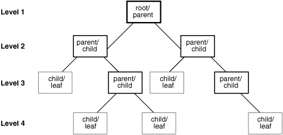

## Hierarchical Query Pseudocolumns

The hierarchical query pseudocolumns are valid only in hierarchical queries. The hierarchical query pseudocolumns are:

To define a hierarchical relationship in a query, you must use the `CONNECT` `BY` clause.

### CONNECT\_BY\_ISCYCLE Pseudocolumn

The `CONNECT_BY_ISCYCLE` pseudocolumn returns 1 if the current row has a child which is also its ancestor. Otherwise it returns 0.

You can specify `CONNECT_BY_ISCYCLE` only if you have specified the `NOCYCLE` parameter of the `CONNECT` `BY` clause. `NOCYCLE` enables Oracle to return the results of a query that would otherwise fail because of a `CONNECT` `BY` loop in the data.

See Also:

[Hierarchical Queries](Hierarchical-Queries.md) for more information about the `NOCYCLE` parameter and [Hierarchical Query Examples](Hierarchical-Queries.md) for an example that uses the `CONNECT_BY_ISCYCLE` pseudocolumn

### CONNECT\_BY\_ISLEAF Pseudocolumn

The `CONNECT_BY_ISLEAF` pseudocolumn returns 1 if the current row is a leaf of the tree defined by the `CONNECT` `BY` condition. Otherwise it returns 0. This information indicates whether a given row can be further expanded to show more of the hierarchy.

CONNECT\_BY\_ISLEAF Example

The following example shows the first three levels of the `hr.employees` table, indicating for each row whether it is a leaf row (indicated by 1 in the `IsLeaf` column) or whether it has child rows (indicated by 0 in the `IsLeaf` column):

```
SELECT last_name "Employee", CONNECT_BY_ISLEAF "IsLeaf",
       LEVEL, SYS_CONNECT_BY_PATH(last_name, '/') "Path"
  FROM employees
  WHERE LEVEL <= 3 AND department_id = 80
  START WITH employee_id = 100
  CONNECT BY PRIOR employee_id = manager_id AND LEVEL <= 4
  ORDER BY "Employee", "IsLeaf";

Employee                      IsLeaf      LEVEL Path
------------------------- ---------- ---------- -------------------------
Abel                               1          3 /King/Zlotkey/Abel
Ande                               1          3 /King/Errazuriz/Ande
Banda                              1          3 /King/Errazuriz/Banda
Bates                              1          3 /King/Cambrault/Bates
Bernstein                          1          3 /King/Russell/Bernstein
Bloom                              1          3 /King/Cambrault/Bloom
Cambrault                          0          2 /King/Cambrault
Cambrault                          1          3 /King/Russell/Cambrault
Doran                              1          3 /King/Partners/Doran
Errazuriz                          0          2 /King/Errazuriz
Fox                                1          3 /King/Cambrault/Fox
. . .
```

See Also:

[Hierarchical Queries](Hierarchical-Queries.md) and [SYS\_CONNECT\_BY\_PATH](SYS_CONNECT_BY_PATH.md)

### LEVEL Pseudocolumn

For each row returned by a hierarchical query, the `LEVEL` pseudocolumn returns 1 for a root row, 2 for a child of a root, and so on. A root row is the highest row within an inverted tree. A child row is any nonroot row. A parent row is any row that has children. A leaf row is any row without children. Figure 3-1 shows the nodes of an inverted tree with their `LEVEL` values.

Figure 3-1 Hierarchical Tree



> ```
> This graphic shows four levels of a hierarchical tree.
> Level 1 contains the root/parent node of the tree.
> A root node is always at the top of a hierarchical tree.
> The root node has two "children" at Level 2. Each of these
> children in turn has children at Level 3. Therefore,
> the Level 2 nodes are parent/child nodes. At Level 3, some of
> the nodes in turn have children at Level 4. These Level 3
> nodes are parent/child nodes. Other Level 3 nodes have no
> children at Level 4. These Level 3 nodes are child/leaf nodes.
> A leaf node has no children at lower levels.
> ```


See Also:

[Hierarchical Queries](Hierarchical-Queries.md) for information on hierarchical queries in general and [IN Condition](IN-Condition.md) for restrictions on using the `LEVEL` pseudocolumn