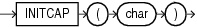

## INITCAP

Syntax



> ```
> INITCAP(char)
> ```
>
> [  
> Copyright © 1996, 2025, Oracle and/or its affiliates.](https://docs.oracle.com/en/database/oracle/oracle-database/dcommon/html/cpyr.htm)


Purpose

`INITCAP` returns `char`, with the first letter of each word in uppercase, all other letters in lowercase. Words are delimited by white space or characters that are not alphanumeric.

`char` can be of any of the data types `CHAR`, `VARCHAR2`, `NCHAR`, or `NVARCHAR2`. The return value is the same data type as `char`. The database sets the case of the initial characters based on the binary mapping defined for the underlying character set. For linguistic-sensitive uppercase and lowercase, refer to [NLS\_INITCAP](NLS_INITCAP.md).

This function does not support `CLOB` data directly. However, `CLOB` s can be passed in as arguments through implicit data conversion.

See Also:

- " [Data Type Comparison Rules](Data-Type-Comparison-Rules.md) " for more information.
- Appendix C in [Oracle Database Globalization Support Guide](https://docs.oracle.com/pls/topic/lookup?ctx=en/database/oracle/oracle-database/21/sqlrf&id=NLSPG-GUID-AFCE41ED-775B-4A00-AF38-C436776AE0C5) for the collation derivation rules, which define the collation assigned to the character return value of `INITCAP`

Examples

The following example capitalizes each word in the string:

```
SELECT INITCAP('the soap') "Capitals"
  FROM DUAL; 

Capitals
---------
The Soap
```