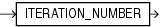

## ITERATION\_NUMBER

Syntax



> ```
> ITERATION_NUMBER
> ```
>
> [  
> Copyright © 1996, 2025, Oracle and/or its affiliates.](https://docs.oracle.com/en/database/oracle/oracle-database/dcommon/html/cpyr.htm)


Purpose

The `ITERATION_NUMBER` function can be used only in the `model_clause` of the `SELECT` statement and then only when `ITERATE(``number``)` is specified in the `model_rules_clause`. It returns an integer representing the completed iteration through the model rules. The `ITERATION_NUMBER` function returns 0 during the first iteration. For each subsequent iteration, the `ITERATION_NUMBER` function returns the equivalent of `iteration_number` plus one.

See Also:

[model\_clause](SELECT.md) and " [Model Expressions](Model-Expressions.md) " for the syntax and semantics

Examples

The following example assigns the sales of the Mouse Pad for the years 1998 and 1999 to the sales of the Mouse Pad for the years 2001 and 2002 respectively:

```
SELECT country, prod, year, s
  FROM sales_view_ref
  MODEL
    PARTITION BY (country)
    DIMENSION BY (prod, year)
    MEASURES (sale s)
    IGNORE NAV
    UNIQUE DIMENSION
    RULES UPSERT SEQUENTIAL ORDER ITERATE(2)
      (
        s['Mouse Pad', 2001 + ITERATION_NUMBER] =
          s['Mouse Pad', 1998 + ITERATION_NUMBER]
      )
  ORDER BY country, prod, year;

COUNTRY       PROD                                         YEAR           S
----------    -----------------------------------      --------   ---------
France        Mouse Pad                                    1998     2509.42
France        Mouse Pad                                    1999     3678.69
France        Mouse Pad                                    2000     3000.72
France        Mouse Pad                                    2001     2509.42
France        Mouse Pad                                    2002     3678.69
France        Standard Mouse                               1998     2390.83
France        Standard Mouse                               1999     2280.45
France        Standard Mouse                               2000     1274.31
France        Standard Mouse                               2001     2164.54
Germany       Mouse Pad                                    1998     5827.87
Germany       Mouse Pad                                    1999     8346.44
Germany       Mouse Pad                                    2000     7375.46
Germany       Mouse Pad                                    2001     5827.87
Germany       Mouse Pad                                    2002     8346.44
Germany       Standard Mouse                               1998     7116.11
Germany       Standard Mouse                               1999     6263.14
Germany       Standard Mouse                               2000     2637.31
Germany       Standard Mouse                               2001     6456.13
 
18 rows selected.
```

The preceding example requires the view `sales_view_ref`. Refer to " [The MODEL clause: Examples](SELECT.md) " to create this view.