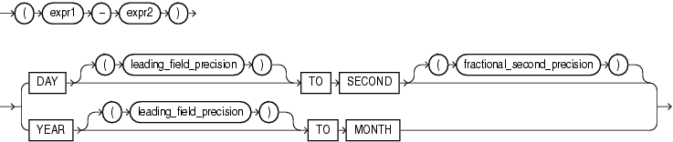

## Interval Expressions

An interval expression yields a value of `INTERVAL` `YEAR` `TO` `MONTH` or `INTERVAL` `DAY` `TO` `SECOND`.

interval\_expression::=



> ```
> ( expr1 - expr2 )
>    { DAY [ (leading_field_precision) ] TO
>      SECOND [ (fractional_second_precision) ]
>    | YEAR [ (leading_field_precision) ] TO
>      MONTH
>    }
> ```
>
> [  
> Copyright © 1996, 2025, Oracle and/or its affiliates.](https://docs.oracle.com/en/database/oracle/oracle-database/dcommon/html/cpyr.htm)


The expressions `expr1` and `expr2` can be any expressions that evaluate to values of data type `DATE`, `TIMESTAMP`, `TIMESTAMP` `WITH` `TIME` `ZONE`, or `TIMESTAMP` `WITH` `LOCAL` `TIME` `ZONE`.

Datetimes and intervals can be combined according to the rules defined in [Table 2-5](Data-Types.md). The six combinations that yield interval values are valid in an interval expression.

Both `leading_field_precision` and `fractional_second_precision` can be any integer from 0 to 9. If you omit the `leading_field_precision` for either `DAY` or `YEAR`, then Oracle Database uses the default value of 2. If you omit the `fractional_second_precision` for second, then the database uses the default value of 6. If the value returned by a query contains more digits that the default precision, then Oracle Database returns an error. Therefore, it is good practice to specify a precision that you know will be at least as large as any value returned by the query.

For example, the following statement subtracts the value of the `order_date` column in the sample table `orders` (a datetime value) from the system timestamp (another datetime value) to yield an interval value expression. It is not known how many days ago the oldest order was placed, so the maximum value of 9 for the `DAY` leading field precision is specified:

```
SELECT (SYSTIMESTAMP - order_date) DAY(9) TO SECOND FROM orders
   WHERE order_id = 2458;
```