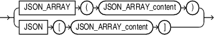
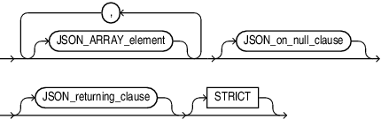
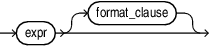
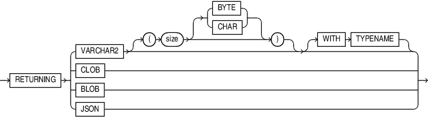

## JSON\_ARRAY

Syntax



> ```
> JSON_ARRAY ( JSON_ARRAY_content )
> ```
>
> [  
> Copyright © 1996, 2025, Oracle and/or its affiliates.](https://docs.oracle.com/en/database/oracle/oracle-database/dcommon/html/cpyr.htm)


JSON\_ARRAY\_content



> ```
> ( JSON_ARRAY_element [ , JSON_ARRAY_element ] ... )
> [ JSON_on_null_clause ] [ JSON_returning_clause ]
> [ STRICT ]
> ```
>
> [  
> Copyright © 1996, 2025, Oracle and/or its affiliates.](https://docs.oracle.com/en/database/oracle/oracle-database/dcommon/html/cpyr.htm)


JSON\_ARRAY\_element



> ```
> expr [ format_clause ]
> ```
>
> [  
> Copyright © 1996, 2025, Oracle and/or its affiliates.](https://docs.oracle.com/en/database/oracle/oracle-database/dcommon/html/cpyr.htm)


JSON\_on\_null\_clause::=


> ```
> { NULL | ABSENT } ON NULL
> ```
>
> [  
> Copyright © 1996, 2025, Oracle and/or its affiliates.](https://docs.oracle.com/en/database/oracle/oracle-database/dcommon/html/cpyr.htm)


JSON\_returning\_clause::=



> ```
> RETURNING 
>  {  VARCHAR2 [( size [BYTE | CHAR] )] 
>    | CLOB 
>    | BLOB
>    | JSON 
>  }
> ```
>
> [  
> Copyright © 1996, 2025, Oracle and/or its affiliates.](https://docs.oracle.com/en/database/oracle/oracle-database/dcommon/html/cpyr.htm)


Purpose

The SQL/JSON function `JSON_ARRAY` takes as its input a sequence of SQL scalar expressions or one collection type instance, `VARRAY` or `NESTED TABLE`.

It converts each expression to a JSON value, and returns a JSON array that contains those JSON values.

If an ADT has a member which is a collection than the type mapping creates a JSON object for the ADT with a nested JSON array for the collection member.

If a collection contains ADT instances then the type mapping will create a JSON array of JSON objects.

JSON\_ARRAY\_content

Use this clause to define the input to the `JSON_ARRAY` function.

JSON\_ARRAY\_element

- expr
	For `expr`, you can specify any SQL expression that evaluates to a JSON object, a JSON array, a numeric literal, a text literal, date, timestamp, or null. This function converts a numeric literal to a JSON number value, and a text literal to a JSON string value. The date and timestamp data types are printed in the generated JSON object or array as JSON Strings following the ISO 8601 date format.
- format\_clause
	You can specify `FORMAT JSON` to indicate that the input string is JSON, and will therefore not be quoted in the output.

JSON\_on\_null\_clause

Use this clause to specify the behavior of this function when `expr` evaluates to null.

- `NULL` `ON` `NULL` - If you specify this clause, then the function returns the JSON null value.
- `ABSENT` `ON` `NULL` - If you specify this clause, then the function omits the value from the JSON array. This is the default.

JSON\_returning\_clause

Use this clause to specify the type of return value. One of:

- `VARCHAR2` specifying the size as a number of bytes or characters. The default is bytes. If you omit this clause, or specify the clause without specifying the `size` value, then `JSON_ARRAY` returns a character string of type `VARCHAR2(4000)`. Refer to [VARCHAR2 Data Type](Data-Types.md) for more information. Note that when specifying the `VARCHAR2` data type elsewhere in SQL, you are required to specify a size. However, in the `JSON_returning_clause` you can omit the size.
- `CLOB` to return a character large object containing single-byte or multi-byte characters.
- `BLOB` to return a binary large object of the `AL32UTF8` character set.

STRICT

Specify the `STRICT` clause to verify that the output of the JSON generation function is correct JSON. If the check fails, a syntax error is raised.

Refer to [JSON\_OBJECT](JSON_OBJECT.md) for examples.

Examples

The following example constructs a JSON array from a JSON object, a JSON array, a numeric literal, a text literal, and null:

```
SELECT JSON_ARRAY (     
    JSON_OBJECT('percentage' VALUE .50),
    JSON_ARRAY(1,2,3),
    100,
    'California',
    null
    NULL ON NULL
    ) "JSON Array Example"
  FROM DUAL;
 
JSON Array Example
--------------------------------------------------------------------------------
[{"percentage":0.5},[1,2,3],100,"California",null]
```