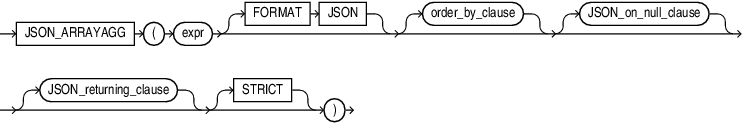

## JSON\_ARRAYAGG

Syntax



> ```
> JSON_ARRAYAGG
>   ( expr [ FORMAT JSON ]  [ order_by_clause ]
>     [ JSON_on_null_clause ] [ JSON_returning_clause ]
>     [ STRICT ] 
>   )
> ```
>
> [  
> Copyright © 1996, 2025, Oracle and/or its affiliates.](https://docs.oracle.com/en/database/oracle/oracle-database/dcommon/html/cpyr.htm)


(See [order\_by\_clause::=](SELECT.md) in the documentation on `SELECT` for the syntax of this clause)

Note:

For `JSON_ARRAYAGG`, the order\_by clause must refer to columns. Positional orders are not supported.

JSON\_on\_null\_clause::=


> ```
> { NULL | ABSENT } ON NULL
> ```
>
> [  
> Copyright © 1996, 2025, Oracle and/or its affiliates.](https://docs.oracle.com/en/database/oracle/oracle-database/dcommon/html/cpyr.htm)


JSON\_returning\_clause::=


> ```
> RETURNING 
>  {  VARCHAR2 [( size [BYTE | CHAR] )] 
>    | CLOB 
>    | BLOB
>    | JSON 
>  }
> ```
>
> [  
> Copyright © 1996, 2025, Oracle and/or its affiliates.](https://docs.oracle.com/en/database/oracle/oracle-database/dcommon/html/cpyr.htm)


Purpose

The SQL/JSON function `JSON_ARRAYAGG` is an aggregate function. It takes as its input a column of SQL expressions, converts each expression to a JSON value, and returns a single JSON array that contains those JSON values.

expr

For `expr`, you can specify any SQL expression that evaluates to a JSON object, a JSON array, a numeric literal, a text literal, or null. This function converts a numeric literal to a JSON number value and a text literal to a JSON string value.

FORMAT JSON

Use this optional clause to indicate that the input string is JSON, and will therefore not be quoted in the output.

order\_by\_clause

This clause allows you to order the JSON values within the JSON array returned by the statement. Refer to the [order\_by\_clause](SELECT.md) in the documentation on `SELECT` for the full semantics of this clause.

JSON\_on\_null\_clause

Use this clause to specify the behavior of this function when `expr` evaluates to null.

- `NULL` `ON` `NULL` - If you specify this clause, then the function returns the JSON null value.
- `ABSENT` `ON` `NULL` - If you specify this clause, then the function omits the value from the JSON array. This is the default.

JSON\_returning\_clause

Use this clause to specify the data type of the character string returned by this function. You can specify the following data types:

- `VARCHAR2[(``size` `[BYTE,CHAR])]`
	When specifying the `VARCHAR2` data type elsewhere in SQL, you are required to specify a size. However, in this clause you can omit the size.
- `CLOB` to return a character large object containing single-byte or multi-byte characters.
- `BLOB` to return a binary large object of the `AL32UTF8` character set.
- `JSON` to return JSON data.
	You must set the database initialization parameter compatible to `20` or greater to use the `JSON` type.

If you omit this clause, or if you specify `VARCHAR2` but omit the `size` value, then `JSON_ARRAYAGG` returns a character string of type `VARCHAR2(4000)`.

Refer to " [Data Types](Data-Types.md) " for more information on the preceding data types.

STRICT

Specify the `STRICT` clause to verify that the output of the JSON generation function is correct JSON. If the check fails, a syntax error is raised.

Refer to [JSON\_OBJECT](JSON_OBJECT.md) for examples.

WITH UNIQUE KEYS

Specify `WITH UNIQUE KEYS` to guarantee that generated JSON objects have unique keys.

Examples

The following statements creates a table `id_table`, which contains ID numbers:

```
CREATE TABLE id_table (id NUMBER);
INSERT INTO id_table VALUES(624);
INSERT INTO id_table VALUES(null);
INSERT INTO id_table VALUES(925);
INSERT INTO id_table VALUES(585);
```

The following example constructs a JSON array from the ID numbers in table `id_table`:

```
SELECT JSON_ARRAYAGG(id ORDER BY id RETURNING VARCHAR2(100)) ID_NUMBERS
  FROM id_table;

ID_NUMBERS
-------------
[585,624,925]
```