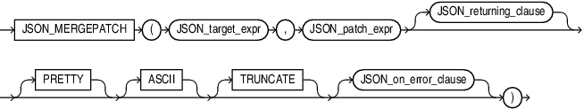
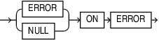

## JSON\_MERGEPATCH

Syntax



> ```
> JSON_MERGEPATCH
>    ( JSON_target_expr , JSON_patch_expr [ JSON_returning_clause ] [ PRETTY ] [ ASCII ] 
>      [ TRUNCATE ] [ JSON_on_error_clause ] )
> ```
>
> [  
> Copyright © 1996, 2025, Oracle and/or its affiliates.](https://docs.oracle.com/en/database/oracle/oracle-database/dcommon/html/cpyr.htm)


JSON\_returning\_clause::=


> ```
> RETURNING 
>  {  VARCHAR2 [( size [BYTE | CHAR] )] 
>    | CLOB 
>    | BLOB
>    | JSON 
>  }
> ```
>
> [  
> Copyright © 1996, 2025, Oracle and/or its affiliates.](https://docs.oracle.com/en/database/oracle/oracle-database/dcommon/html/cpyr.htm)


json\_on\_error\_clause::=



> ```
> ( ERROR | NULL) ON ERROR
> ```
>
> [  
> Copyright © 1996, 2025, Oracle and/or its affiliates.](https://docs.oracle.com/en/database/oracle/oracle-database/dcommon/html/cpyr.htm)


Purpose

You can use the `JSON_MERGEPATCH` function to update specific portions of a JSON document. You pass it a JSON Merge Patch document in `JSON_patch_expr`, which specifies the changes to make to a specified JSON document, the `JSON_target_expr`.

`JSON_MERGEPATCH` evaluates the patch document against the target document to produce the result document. If the target or the patch document is NULL, then the result is also NULL.

You can input any SQL datatype that supports JSON data: `JSON`, `VARCHAR2`, `CLOB`, or `BLOB`. The function returns any of the SQL datatypes as output.

Data type `JSON` is available only if database initialization parameter compatible is `20` or greater.

The default return type depends on the input data type. If the input type is `JSON`, then `JSON` is also the default return type. Otherwise, `VARCHAR2` is the default return type.

The `JSON_returning_clause` specifies the return type of the operator. The default return type is `VARCHAR2(4000)`.

The `PRETTY` keyword specifies that the result should be formatted for human readability.

The `ASCII` keyword specifies that non-ASCII characters should be output using JSON escape sequences.

The `TRUNCATE` keyword specifies that the result document should be truncated to fit in the specified return type.

The `JSON_on_error_clause` optionally controls the handling of errors that occur during the processing of the target and patch documents.

- `NULL ON ERROR` - Returns null when an error occurs. This is the default.
- `ERROR ON ERROR` - Returns the appropriate Oracle error when an error occurs.

See Also:

- [RFC 7396 JSON Merge Patch](https://tools.ietf.org/html/rfc7396)
- [Updating a JSON Document with JSON Merge Patch](https://docs.oracle.com/pls/topic/lookup?ctx=en/database/oracle/oracle-database/21/sqlrf&id=ADJSN-GUID-31F88F28-3D92-489B-9CCD-BD1931B91F1F)