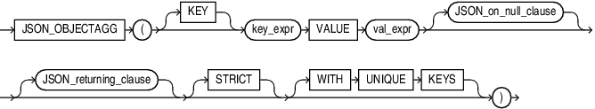

## JSON\_OBJECTAGG

Syntax



> ```
> JSON_OBJECTAGG
>   ( [ KEY ] key_expr VALUE val_expr [ JSON_on_null_clause ] 
>     [ JSON_agg_returning_clause ] [ STRICT ] [ WITH UNIQUE KEYS ]
>   )
> ```
>
> [  
> Copyright © 1996, 2025, Oracle and/or its affiliates.](https://docs.oracle.com/en/database/oracle/oracle-database/dcommon/html/cpyr.htm)


JSON\_on\_null\_clause::=


> ```
> { NULL | ABSENT } ON NULL
> ```
>
> [  
> Copyright © 1996, 2025, Oracle and/or its affiliates.](https://docs.oracle.com/en/database/oracle/oracle-database/dcommon/html/cpyr.htm)


JSON\_returning\_clause::=


> ```
> RETURNING 
>  {  VARCHAR2 [( size [BYTE | CHAR] )] 
>    | CLOB 
>    | BLOB
>    | JSON 
>  }
> ```
>
> [  
> Copyright © 1996, 2025, Oracle and/or its affiliates.](https://docs.oracle.com/en/database/oracle/oracle-database/dcommon/html/cpyr.htm)


Purpose

The SQL/JSON function `JSON_OBJECTAGG` is an aggregate function. It takes as its input a property key-value pair. Typically, the property key, the property value, or both are columns of SQL expressions. This function constructs an object member for each key-value pair and returns a single JSON object that contains those object members.

\[KEY\] string VALUE expr

Use this clause to specify property key-value pairs.

- `KEY` is optional and is provided for semantic clarity.
- Use `string` to specify the property key name as a case-sensitive text literal.
- Use `expr` to specify the property value. For `expr`, you can specify any expression that evaluates to a SQL numeric literal, text literal, date, or timestamp. The date and timestamp data types are printed in the generated JSON object or array as JSON Strings following the ISO 8601 date format. If `expr` evaluates to a numeric literal, then the resulting property value is a JSON number value; otherwise, the resulting property value is a case-sensitive JSON string value enclosed in double quotation marks.

FORMAT JSON

Use this optional clause to indicate that the input string is JSON, and will therefore not be quoted in the output.

JSON\_on\_null\_clause

Use this clause to specify the behavior of this function when `expr` evaluates to null.

- `NULL` `ON` `NULL` - When NULL ON NULL is specified, then a JSON NULL value is used as a value for the given key.
- `ABSENT` `ON` `NULL` - If you specify this clause, then the function omits the property key-value pair from the JSON object.

JSON\_returning\_clause

Use this clause to specify the data type of the character string returned by this function. You can specify the following data types:

- `VARCHAR2[(``size` `[BYTE,CHAR])]`
	When specifying the `VARCHAR2` data type elsewhere in SQL, you are required to specify a size. However, in this clause you can omit the size.
- `CLOB` to return a character large object containing single-byte or multi-byte characters.
- `BLOB` to return a binary large object of the `AL32UTF8` character set.
- `JSON` to return JSON data.
	You must set the database initialization parameter compatible to `20` or greater to use the `JSON` data type.

If you omit this clause, or if you specify `VARCHAR2` but omit the `size` value, then `JSON_OBJECTAGG` returns a character string of type `VARCHAR2(4000)`.

Refer to " [Data Types](Data-Types.md) " for more information on the preceding data types.

STRICT

Specify the `STRICT` clause to verify that the output of the JSON generation function is correct JSON. If the check fails, a syntax error is raised.

Refer to [JSON\_OBJECT](JSON_OBJECT.md) for examples.

WITH UNIQUE KEYS

Specify `WITH UNIQUE KEYS` to guarantee that generated JSON objects have unique keys.

Examples

The following example constructs a JSON object whose members contain department names and department numbers:

```
SELECT JSON_OBJECTAGG(KEY department_name VALUE department_id) "Department Numbers"
  FROM departments
  WHERE department_id <= 30;

Department Numbers
----------------------------------------------------
{"Administration":10,"Marketing":20,"Purchasing":30}
```