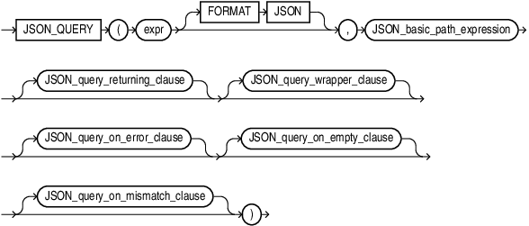
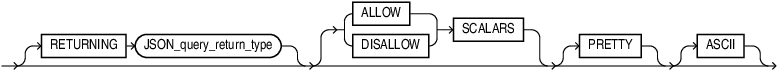
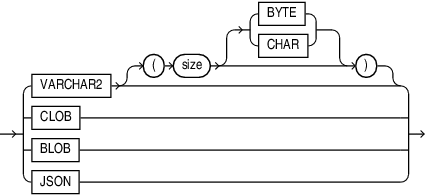
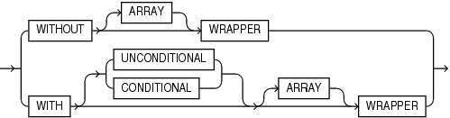
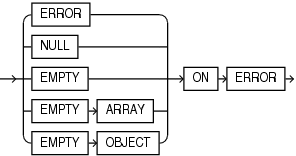
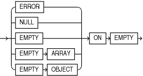
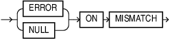

## JSON\_QUERY

Syntax



> ```
> JSON_QUERY
>   ( expr [ FORMAT JSON ], JSON_basic_path_expression
>     [ JSON_query_returning_clause ] [ JSON_query_wrapper_clause ]
>     [ JSON_query_on_error_clause ] [ JSON_query_on_empty_clause ]
>     [ JSON_query_on_mismatch_clause ]
>   )
> ```
>
> [  
> Copyright © 1996, 2025, Oracle and/or its affiliates.](https://docs.oracle.com/en/database/oracle/oracle-database/dcommon/html/cpyr.htm)


(`JSON_basic_path_expression`: See [Oracle Database JSON Developer's Guide](https://docs.oracle.com/pls/topic/lookup?ctx=en/database/oracle/oracle-database/21/sqlrf&id=ADJSN-GUID-8241AE93-89BE-40E6-89E2-8F9C1A9244F4))

JSON\_query\_returning\_clause::=



> ```
> [ RETURNING JSON_query_return_type ] [ (ALLOW | DISALLOW) SCALARS ] [ PRETTY ] [ ASCII ]
> ```
>
> [  
> Copyright © 1996, 2025, Oracle and/or its affiliates.](https://docs.oracle.com/en/database/oracle/oracle-database/dcommon/html/cpyr.htm)


JSON\_query\_return\_type::=



> ```
> VARCHAR2 [ ( size [BYTE | CHAR] [ TRUNCATE ]) ]
> | CLOB
> | BLOB
> ```
>
> [  
> Copyright © 1996, 2025, Oracle and/or its affiliates.](https://docs.oracle.com/en/database/oracle/oracle-database/dcommon/html/cpyr.htm)


JSON\_query\_wrapper\_clause::=



> ```
> WITHOUT [ ARRAY ] WRAPPER
> | WITH [ UNCONDITIONAL | CONDITIONAL ] [ ARRAY ] WRAPPER
> ```
>
> [  
> Copyright © 1996, 2025, Oracle and/or its affiliates.](https://docs.oracle.com/en/database/oracle/oracle-database/dcommon/html/cpyr.htm)


JSON\_query\_on\_error\_clause::=



> ```
> { ERROR
> | NULL
> | EMPTY
> | EMPTY ARRAY
> | EMPTY OBJECT
> } ON ERROR
> ```
>
> [  
> Copyright © 1996, 2025, Oracle and/or its affiliates.](https://docs.oracle.com/en/database/oracle/oracle-database/dcommon/html/cpyr.htm)


JSON\_query\_on\_empty\_clause::=



> ```
> { ERROR
> | NULL
> | EMPTY
> | EMPTY ARRAY
> | EMPTY OBJECT
> } ON EMPTY
> ```
>
> [  
> Copyright © 1996, 2025, Oracle and/or its affiliates.](https://docs.oracle.com/en/database/oracle/oracle-database/dcommon/html/cpyr.htm)


JSON\_query\_on\_mismatch\_clause::=



> ```
> { ERROR | NULL } ON MISMATCH
> ```
>
> [  
> Copyright © 1996, 2025, Oracle and/or its affiliates.](https://docs.oracle.com/en/database/oracle/oracle-database/dcommon/html/cpyr.htm)


Purpose

`JSON_QUERY` selects and returns one or more values from JSON data and returns those values. You can use `JSON_QUERY` to retrieve fragments of a JSON document.

See Also:

- [Query JSON Data](https://docs.oracle.com/pls/topic/lookup?ctx=en/database/oracle/oracle-database/21/sqlrf&id=ADJSN-GUID-119E5069-77F2-45DC-B6F0-A1B312945590)
- Appendix C in [Oracle Database Globalization Support Guide](https://docs.oracle.com/pls/topic/lookup?ctx=en/database/oracle/oracle-database/21/sqlrf&id=NLSPG-GUID-AFCE41ED-775B-4A00-AF38-C436776AE0C5) for the collation derivation rules, which define the collation assigned to the character value returned by `JSON_QUERY`

expr

Use `expr` to specify the JSON data you want to query.

`expr` is a SQL expression that returns an instance of a SQL data type, one of `JSON`, `VARCHAR2`, `CLOB`, or `BLOB`. It can be a table or view column value, a PL/SQLvariable, or a bind variable with proper casting.

If `expr` is null, then the function returns null.

If `expr` is not a text literal of well-formed JSON data using strict or lax syntax, then the function returns null by default. You can use the `JSON_query_on_error_clause` to override this default behavior. Refer to JSON\_query\_on\_error\_clause.

FORMAT JSON

You must specify `FORMAT` `JSON` if `expr` is a column of data type `BLOB`.

JSON\_basic\_path\_expression

Use this clause to specify a SQL/JSON path expression. The function uses the path expression to evaluate `expr` and find one or more JSON values that match, or satisfy the path expression. The path expression must be a text literal. See [Oracle Database JSON Developer's Guide](https://docs.oracle.com/pls/topic/lookup?ctx=en/database/oracle/oracle-database/21/sqlrf&id=ADJSN-GUID-7B610884-39CD-4910-85E7-C251D342D879) for the full semantics of `JSON_basic_path_expression`.

JSON\_query\_returning\_clause

Use this clause to specify the data type and format of the character string returned by this function.

RETURNING

You can use the `RETURNING` clause to specify the data type of the returned instance, one of `JSON`, `VARCHAR2`, `CLOB`, or `BLOB`.

The default return type depends on the input data type. If the input type is `JSON`, then `JSON` is also the default return type. Otherwise `VARCHAR2(4000)` is the default return type.

When specifying the `VARCHAR2` data type elsewhere in SQL, you are required to specify a size. However, in this clause you can omit the size. In this case, `JSON_QUERY` returns a character string of type `VARCHAR2(4000)`.

Refer to " [VARCHAR2 Data Type](Data-Types.md) " for more information.

If the data type is not large enough to hold the return character string, then `JSON_QUERY` returns null by default. You can use the `JSON_query_on_error_clause` to override this default behavior. Refer to the JSON\_query\_on\_error\_clause.

PRETTY

Specify `PRETTY` to pretty-print the return character string by inserting newline characters and indenting.

ASCII

Specify `ASCII` to automatically escape any non-ASCII Unicode characters in the return character string, using standard ASCII Unicode escape sequences.

JSON\_query\_wrapper\_clause

Use this clause to control whether this function wraps the values matched by the path expression in an array wrapper—that is, encloses the sequence of values in square brackets (`[]`).

- Specify `WITHOUT` `WRAPPER` to omit the array wrapper. You can specify this clause only if the path expression matches a single JSON object or JSON array. This is the default.
- Specify `WITH` `WRAPPER` to include the array wrapper. You must specify this clause if the path expression matches a single scalar value (a value that is not a JSON object or JSON array) or multiple values of any type.
- Specifying the `WITH` `UNCONDITIONAL` `WRAPPER` clause is equivalent to specifying the `WITH` `WRAPPER` clause. The `UNCONDITIONAL` keyword is provided for semantic clarity.
- Specify `WITH` `CONDITIONAL` `WRAPPER` to include the array wrapper only if the path expression matches a single scalar value or multiple values of any type. If the path expression matches a single JSON object or JSON array, then the array wrapper is omitted.

The `ARRAY` keyword is optional and is provided for semantic clarity.

If the function returns a single scalar value, or multiple values of any type, and you do not specify `WITH` `[UNCONDITIONAL` `|` `CONDITIONAL]` `WRAPPER`, then the function returns null by default. You can use the `JSON_query_on_error_clause` to override this default behavior. Refer to the JSON\_query\_on\_error\_clause.

JSON\_query\_on\_error\_clause

Use this clause to specify the value returned by this function when the following errors occur:

- `expr` is not well-formed JSON data using strict or lax JSON syntax
- No match is found when the JSON data is evaluated using the SQL/JSON path expression. You can override the behavior for this type of error by specifying the `JSON_query_on_empty_clause`.
- The return value data type is not large enough to hold the return character string
- The function matches a single scalar value or, multiple values of any type, and the `WITH` `[UNCONDITIONAL` `|` `CONDITIONAL]` `WRAPPER` clause is not specified

You can specify the following clauses:

- `NULL` `ON` `ERROR` - Returns null when an error occurs. This is the default.
- `ERROR` `ON` `ERROR` - Returns the appropriate Oracle error when an error occurs.
- `EMPTY` `ON` `ERROR` - Specifying this clause is equivalent to specifying `EMPTY` `ARRAY` `ON` `ERROR`.
- `EMPTY` `ARRAY` `ON` `ERROR` - Returns an empty JSON array (`[]`) when an error occurs.
- `EMPTY` `OBJECT` `ON` `ERROR` - Returns an empty JSON object (`{}`) when an error occurs.

JSON\_query\_on\_empty\_clause

Use this clause to specify the value returned by this function if no match is found when the JSON data is evaluated using the SQL/JSON path expression. This clause allows you to specify a different outcome for this type of error than the outcome specified with the `JSON_query_on_error_clause`.

You can specify the following clauses:

- `NULL` `ON` `EMPTY` - Returns null when no match is found.
- `ERROR` `ON` `EMPTY` - Returns the appropriate Oracle error when no match is found.
- `EMPTY` `ON` `EMPTY` - Specifying this clause is equivalent to specifying `EMPTY` `ARRAY` `ON` `EMPTY`.
- `EMPTY` `ARRAY` `ON` `EMPTY` - Returns an empty JSON array (`[]`) when no match is found.
- `EMPTY` `OBJECT` `ON` `EMPTY` - Returns an empty JSON object (`{}`) when no match is found.

If you omit this clause, then the `JSON_query_on_error_clause` determines the value returned when no match is found.

Examples

The following query returns the context item, or the specified string of JSON data. The path expression matches a single JSON object, which does not require an array wrapper. Note that the JSON data is converted to strict JSON syntax in the returned value—that is, the object property names are enclosed in double quotation marks.

```
SELECT JSON_QUERY('{a:100, b:200, c:300}', '$') AS value
  FROM DUAL;

VALUE
--------------------------------------------------------------------------------
{"a":100,"b":200,"c":300}
```

The following query returns the value of the member with property name `a`. The path expression matches a scalar value, which must be enclosed in an array wrapper. Therefore, the `WITH` `WRAPPER` clause is specified.

```
SELECT JSON_QUERY('{a:100, b:200, c:300}', '$.a' WITH WRAPPER) AS value
  FROM DUAL;

VALUE
--------------------------------------------------------------------------------
[100]
```

The following query returns the values of all object members. The path expression matches multiple values, which together must be enclosed in an array wrapper. Therefore, the `WITH` `WRAPPER` clause is specified.

```
SELECT JSON_QUERY('{a:100, b:200, c:300}', '$.*' WITH WRAPPER) AS value
  FROM DUAL;

VALUE
--------------------------------------------------------------------------------
[100,200,300]
```

The following query returns the context item, or the specified string of JSON data. The path expression matches a single JSON array, which does not require an array wrapper.

```
SELECT JSON_QUERY('[0,1,2,3,4]', '$') AS value
  FROM DUAL;

VALUE
--------------------------------------------------------------------------------
[0,1,2,3,4]
```

The following query is similar to the previous query, except the `WITH` `WRAPPER` clause is specified. Therefore, the JSON array is wrapped in an array wrapper.

```
SELECT JSON_QUERY('[0,1,2,3,4]', '$' WITH WRAPPER) AS value
  FROM DUAL;

VALUE
--------------------------------------------------------------------------------
[[0,1,2,3,4]]
```

The following query returns all elements in a JSON array. The path expression matches multiple values, which together must be enclosed in an array wrapper. Therefore, the `WITH` `WRAPPER` clause is specified.

```
SELECT JSON_QUERY('[0,1,2,3,4]', '$[*]' WITH WRAPPER) AS value
  FROM DUAL;

VALUE
--------------------------------------------------------------------------------
[0,1,2,3,4]
```

The following query returns the elements at indexes 0, 3 through 5, and 7 in a JSON array. The path expression matches multiple values, which together must be enclosed in an array wrapper. Therefore, the `WITH` `WRAPPER` clause is specified.

```
SELECT JSON_QUERY('[0,1,2,3,4,5,6,7,8]', '$[0, 3 to 5, 7]' WITH WRAPPER) AS value
  FROM DUAL;

VALUE
--------------------------------------------------------------------------------
[0,3,4,5,7]
```

The following query returns the fourth element in a JSON array. The path expression matches a scalar value, which must be enclosed in an array wrapper. Therefore, the `WITH` `WRAPPER` clause is specified.

```
SELECT JSON_QUERY('[0,1,2,3,4]', '$[3]' WITH WRAPPER) AS value
  FROM DUAL;

VALUE
--------------------------------------------------------------------------------
[3]
```

The following query returns the first element in a JSON array. The `WITH` `CONDITIONAL` `WRAPPER` clause is specified and the path expression matches a single JSON object. Therefore, the value returned is not wrapped in an array. Note that the JSON data is converted to strict JSON syntax in the returned value—that is, the object property name is enclosed in double quotation marks.

```
SELECT JSON_QUERY('[{a:100},{b:200},{c:300}]', '$[0]'
       WITH CONDITIONAL WRAPPER) AS value
  FROM DUAL;

VALUE
--------------------------------------------------------------------------------
{"a":100}
```

The following query returns all elements in a JSON array. The `WITH` `CONDITIONAL` `WRAPPER` clause is specified and the path expression matches multiple JSON objects. Therefore, the value returned is wrapped in an array.

```
SELECT JSON_QUERY('[{"a":100},{"b":200},{"c":300}]', '$[*]'
       WITH CONDITIONAL WRAPPER) AS value
  FROM DUAL;

VALUE
--------------------------------------------------------------------------------
[{"a":100},{"b":200},{"c":300}]
```

The following query is similar to the previous query, except that the value returned is of data type `VARCHAR2(100)`.

```
SELECT JSON_QUERY('[{"a":100},{"b":200},{"c":300}]', '$[*]'
       RETURNING VARCHAR2(100) WITH CONDITIONAL WRAPPER) AS value
  FROM DUAL;

VALUE
--------------------------------------------------------------------------------
[{"a":100},{"b":200},{"c":300}]
```

The following query returns the fourth element in a JSON array. However, the supplied JSON array does not contain a fourth element, which results in an error. The `EMPTY` `ON` `ERROR` clause is specified. Therefore, the query returns an empty JSON array.

```
SELECT JSON_QUERY('[{"a":100},{"b":200},{"c":300}]', '$[3]'
       EMPTY ON ERROR) AS value
  FROM DUAL;

VALUE
--------------------------------------------------------------------------------
[]
```