## JSON\_TRANSFORM

Syntax

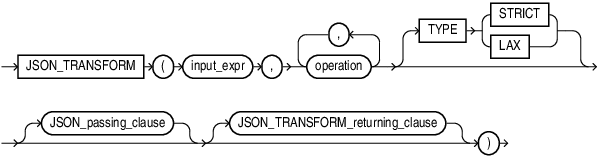

> ```
> JSON_TRANSFORM ( input_expr , operation [ , operation ]...
>     [ JSON_passing_clause ] 
>     [ JSON_TRANSFORM_returning_clause ] )
> ```
>
> [  
> Copyright © 1996, 2025, Oracle and/or its affiliates.](https://docs.oracle.com/en/database/oracle/oracle-database/dcommon/html/cpyr.htm)


JSON\_TRANSFORM\_returning\_clause::=

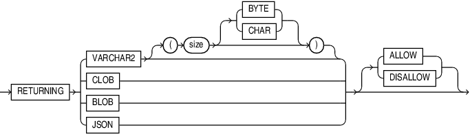

> ```
> RETURNING ( 
>      VARCHAR2 [ ( size [BYTE | CHAR] ) ]
>      | CLOB
>      | BLOB
>      | JSON
>     )
>    [ (ALLOW | DISALLOW) ]
> ```
>
> [  
> Copyright © 1996, 2025, Oracle and/or its affiliates.](https://docs.oracle.com/en/database/oracle/oracle-database/dcommon/html/cpyr.htm)


JSON\_passing\_clause::=

For details on `JSON_passing_clause` see [JSON\_EXISTS Condition](SQL-JSON-Conditions.md).

operation::=

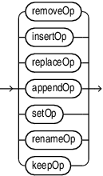

> ```
> removeOp
> | insertOp
> | replaceOp 
> | appendOp
> | setOp
> | renameOp
> | keepOp
> ```
>
> [  
> Copyright © 1996, 2025, Oracle and/or its affiliates.](https://docs.oracle.com/en/database/oracle/oracle-database/dcommon/html/cpyr.htm)


removeOp::=

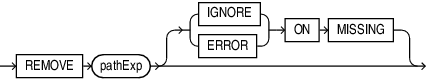

> ```
> REMOVE pathExpr [ (IGNORE | ERROR) ON MISSING ]
> ```
>
> [  
> Copyright © 1996, 2025, Oracle and/or its affiliates.](https://docs.oracle.com/en/database/oracle/oracle-database/dcommon/html/cpyr.htm)


insertOp::=

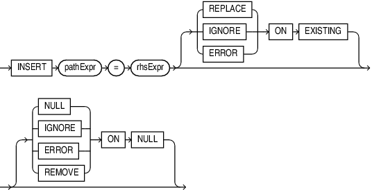

> ```
> INSERT pathExpr = rhsExpr [ ( REPLACE | IGNORE | ERROR) ON EXISTING ]
>      [ ( NULL | IGNORE | ERROR | REMOVE ) ON NULL ]
> ```
>
> [  
> Copyright © 1996, 2025, Oracle and/or its affiliates.](https://docs.oracle.com/en/database/oracle/oracle-database/dcommon/html/cpyr.htm)


replaceOp::=

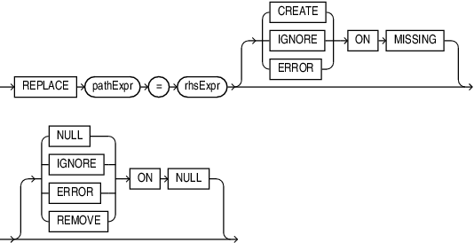

> ```
> REPLACE pathExpr = rhsExpr [ ( CREATE | IGNORE | ERROR) ON MISSING ]
>     [ ( NULL | IGNORE | ERROR | REMOVE ) ON NULL ]
> ```
>
> [  
> Copyright © 1996, 2025, Oracle and/or its affiliates.](https://docs.oracle.com/en/database/oracle/oracle-database/dcommon/html/cpyr.htm)


rhsExpr::=

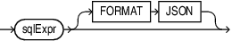

> ```
> sqlExpr [ FORMAT JSON ]
> ```
>
> [  
> Copyright © 1996, 2025, Oracle and/or its affiliates.](https://docs.oracle.com/en/database/oracle/oracle-database/dcommon/html/cpyr.htm)


appendOp::=

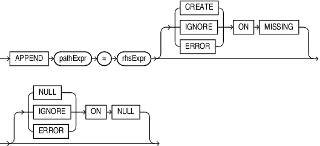

> ```
> APPEND pathExpr = rhsExpr [ ( CREATE | IGNORE | ERROR) ON MISSING ]
>     [ ( NULL | IGNORE | ERROR) ON NULL ]
> ```
>
> [  
> Copyright © 1996, 2025, Oracle and/or its affiliates.](https://docs.oracle.com/en/database/oracle/oracle-database/dcommon/html/cpyr.htm)


setOp::=

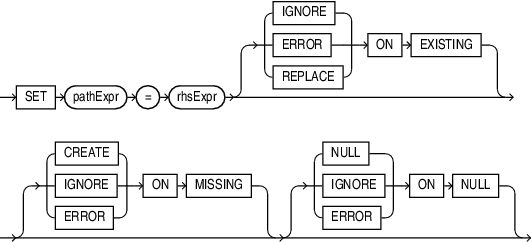

> ```
> SET pathExpr = rhsExpr [ (IGNORE | ERROR | REPLACE) ON EXISTING ]
>     [ ( CREATE | IGNORE | ERROR) ON MISSING ] [ ( NULL | IGNORE | ERROR) ON NULL ]
> ```
>
> [  
> Copyright © 1996, 2025, Oracle and/or its affiliates.](https://docs.oracle.com/en/database/oracle/oracle-database/dcommon/html/cpyr.htm)


renameOp::=

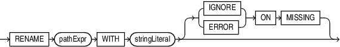

> ```
> RENAME pathExpr WITH stringLiteral [ (IGNORE | ERROR) ON MISSING ]
> ```
>
> [  
> Copyright © 1996, 2025, Oracle and/or its affiliates.](https://docs.oracle.com/en/database/oracle/oracle-database/dcommon/html/cpyr.htm)


keepOp::=

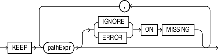

> ```
> KEEP ( pathExpr [( IGNORE | ERROR ) ON MISSING ] ) ...
> ```
>
> [  
> Copyright © 1996, 2025, Oracle and/or its affiliates.](https://docs.oracle.com/en/database/oracle/oracle-database/dcommon/html/cpyr.htm)


Purpose

You can use the `JSON_TRANSFORM ` function to change input JSON data (or pieces of JSON data), by specifying one or more modifying operations that perform changes to the JSON data. You will get the modified JSON as output.

The input to the function is a SQL expression that contains a JSON value. For example, the input can be a `JSON` type instance, a `VARCHAR2` column with or without an `IS JSON` check constraint, or a function call returning JSON data.

Examples

Example 1: Update a JSON Column with a Timestamp

```
UPDATE t SET jcol = JSON_TRANSFORM(jcol, SET '$.lastUpdated' = SYSTIMESTAMP)
```

Example 2: Remove a Social Security Number before Shipping JSON to a Client

```
SELECT JSON_TRANSFORM (jcol, REMOVE '$.ssn') FROM t WHERE …
```

JSON\_TRANSFORM\_returning\_clause

If the input data is JSON, then the output data type is also JSON. For all other input types, the default output data type is `VARCHAR2(4000)`.

For a fuller discussion of `JSON_TRANSFORM ` with examples, see [Oracle SQL Function JSON\_TRANSFORM](https://docs.oracle.com/pls/topic/lookup?ctx=en/database/oracle/oracle-database/21/sqlrf&id=ADJSN-GUID-7BED994B-EAA3-4FF0-824D-C12ADAB862C1).