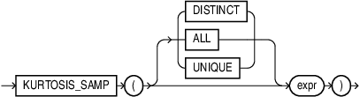

## KURTOSIS\_SAMP

Syntax



> ```
> KURTOSIS_SAMP ( [DISTINCT | ALL | UNIQUE] expr )
> ```
>
> [  
> Copyright © 1996, 2025, Oracle and/or its affiliates.](https://docs.oracle.com/en/database/oracle/oracle-database/dcommon/html/cpyr.htm)


Purpose

The sample kurtosis function `KURTOSIS_SAMP` is primarily used to determine the characteristics of outliers in a given distribution.

NULL values in `expr` are ignored.

Returns NULL if all rows in the group have NULL `expr` values.

Returns 0 if there are one or two rows in `expr`.

For a given set of values, the result of sample kurtosis (`KURTOSIS_SAMP`) and population kurtosis (`KURTOSIS_POP`) are always deterministic. However, the values of `KURTOSIS_SAMP` and `KURTOSIS_POP` differ. As the number of values in the data set increases, the difference between the computed values of `KURTOSIS_SAMP` and `KURTOSIS_POP` decreases.