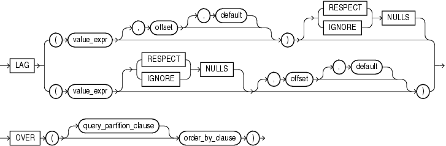

## LAG

Syntax



> ```
> LAG
>   { ( value_expr [, offset [, default]]) [ { RESPECT | IGNORE } NULLS ] 
>   | ( value_expr [ { RESPECT | IGNORE } NULLS ] [, offset [, default]] )
>   }
>   OVER ([ query_partition_clause ] order_by_clause)
> ```
>
> [  
> Copyright © 1996, 2025, Oracle and/or its affiliates.](https://docs.oracle.com/en/database/oracle/oracle-database/dcommon/html/cpyr.htm)


See Also:

" [Analytic Functions](Analytic-Functions.md) " for information on syntax, semantics, and restrictions, including valid forms of `value_expr`

Purpose

`LAG` is an analytic function. It provides access to more than one row of a table at the same time without a self join. Given a series of rows returned from a query and a position of the cursor, `LAG` provides access to a row at a given physical offset prior to that position.

For the optional `offset` argument, specify an integer that is greater than zero. If you do not specify `offset`, then its default is 1. The optional `default` value is returned if the offset goes beyond the scope of the window. If you do not specify `default`, then its default is null.

{ `RESPECT` | `IGNORE` } `NULLS` determines whether null values of `value_expr` are included in or eliminated from the calculation. The default is `RESPECT` `NULLS`.

You cannot nest analytic functions by using `LAG` or any other analytic function for `value_expr`. However, you can use other built-in function expressions for `value_expr`.

See Also:

- " [About SQL Expressions](About-SQL-Expressions.md) " for information on valid forms of `expr` and [LEAD](LEAD.md)
- Appendix C in [Oracle Database Globalization Support Guide](https://docs.oracle.com/pls/topic/lookup?ctx=en/database/oracle/oracle-database/21/sqlrf&id=NLSPG-GUID-AFCE41ED-775B-4A00-AF38-C436776AE0C5) for the collation derivation rules, which define the collation assigned to the return value of `LAG` when it is a character value

Examples

The following example provides, for each purchasing clerk in the `employees` table, the salary of the employee hired just before:

```
SELECT hire_date, last_name, salary,
       LAG(salary, 1, 0) OVER (ORDER BY hire_date) AS prev_sal
  FROM employees
  WHERE job_id = 'PU_CLERK'
  ORDER BY hire_date;
   
HIRE_DATE LAST_NAME                     SALARY   PREV_SAL
--------- ------------------------- ---------- ----------
18-MAY-03 Khoo                            3100          0
24-JUL-05 Tobias                          2800       3100
24-DEC-05 Baida                           2900       2800
15-NOV-06 Himuro                          2600       2900
10-AUG-07 Colmenares                      2500       2600
```