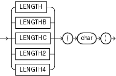

## LENGTH

Syntax

length::=



> ```
> { LENGTH
> | LENGTHB
> | LENGTHC
> | LENGTH2
> | LENGTH4
> }
> (char)
> ```
>
> [  
> Copyright © 1996, 2025, Oracle and/or its affiliates.](https://docs.oracle.com/en/database/oracle/oracle-database/dcommon/html/cpyr.htm)


Purpose

The `LENGTH` functions return the length of `char`. `LENGTH` calculates length using characters as defined by the input character set. `LENGTHB` uses bytes instead of characters. `LENGTHC` uses Unicode complete characters. `LENGTH2` uses UCS2 code points. `LENGTH4` uses UCS4 code points.

`char` can be any of the data types `CHAR`, `VARCHAR2`, `NCHAR`, `NVARCHAR2`, `CLOB`, or `NCLOB`. The exceptions are `LENGTHC`, `LENGTH2`, and `LENGTH4`, which do not allow `char` to be a `CLOB` or `NCLOB`. The return value is of data type `NUMBER`. If `char` has data type `CHAR`, then the length includes all trailing blanks. If `char` is null, then this function returns null.

- [Oracle Database Globalization Support Guide](https://docs.oracle.com/pls/topic/lookup?ctx=en/database/oracle/oracle-database/21/sqlrf&id=NLSPG435)
- [Oracle Database SecureFiles and Large Objects Developer's Guide](https://docs.oracle.com/pls/topic/lookup?ctx=en/database/oracle/oracle-database/21/sqlrf&id=ADLOB45586)

Restriction on LENGTHB

The `LENGTHB` function is supported for single-byte LOBs only. It cannot be used with `CLOB` and `NCLOB` data in a multibyte character set.

Examples

The following example uses the `LENGTH` function using a single-byte database character set:

```
SELECT LENGTH('CANDIDE') "Length in characters"
  FROM DUAL;

Length in characters
--------------------
                   7
```

The next example assumes a double-byte database character set.

```
SELECT LENGTHB ('CANDIDE') "Length in bytes"
  FROM DUAL;
 
Length in bytes
---------------
             14
```