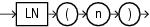

## LN

Syntax



> ```
> LN(n)
> ```
>
> [  
> Copyright © 1996, 2025, Oracle and/or its affiliates.](https://docs.oracle.com/en/database/oracle/oracle-database/dcommon/html/cpyr.htm)


Purpose

`LN` returns the natural logarithm of `n`, where `n` is greater than 0.

This function takes as an argument any numeric data type or any nonnumeric data type that can be implicitly converted to a numeric data type. If the argument is `BINARY_FLOAT`, then the function returns `BINARY_DOUBLE`. Otherwise the function returns the same numeric data type as the argument.

See Also:

[Table 2-8](Data-Type-Comparison-Rules.md) for more information on implicit conversion

Examples

The following example returns the natural logarithm of 95:

```
SELECT LN(95) "Natural log of 95"
  FROM DUAL;

Natural log of 95
-----------------
       4.55387689
```