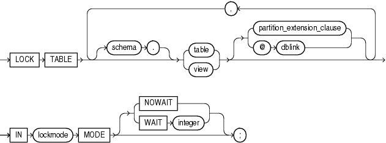
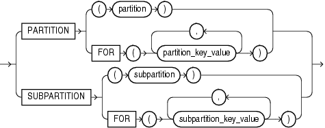

## LOCK TABLE

Purpose

Use the `LOCK` `TABLE` statement to lock one or more tables, table partitions, or table subpartitions in a specified mode. This lock manually overrides automatic locking and permits or denies access to a table or view by other users for the duration of your operation.

Some forms of locks can be placed on the same table at the same time. Other locks allow only one lock for a table.

A locked table remains locked until you either commit your transaction or roll it back, either entirely or to a savepoint before you locked the table.

A lock never prevents other users from querying the table. A query never places a lock on a table. Readers never block writers and writers never block readers.

Prerequisites

The table or view must be in your own schema, or you must have the `LOCK` `ANY` `TABLE` system privilege, or you must have any object privilege (except the `READ` object privilege) on the table or view.

Syntax

lock\_table::=



> ```
> LOCK TABLE [ schema. ] { table | view }
>    [ partition_extension_clause
>    | @ dblink
>    ] [, [ schema. ] { table | view }
>       [ partition_extension_clause
>       | @ dblink
>       ]
>      ]...
>    IN lockmode MODE
>    [ NOWAIT
>    | WAIT integer
>    ] ;
> ```
>
> [  
> Copyright © 1996, 2025, Oracle and/or its affiliates.](https://docs.oracle.com/en/database/oracle/oracle-database/dcommon/html/cpyr.htm)


partition\_extension\_clause::=



> ```
> { PARTITION (partition)
> | PARTITION FOR (partition_key_value [, partition_key_value]...)
> | SUBPARTITION (subpartition)
> | SUBPARTITION FOR (subpartition_key_value [, subpartition_key_value]...)
> }
> ```
>
> [  
> Copyright © 1996, 2025, Oracle and/or its affiliates.](https://docs.oracle.com/en/database/oracle/oracle-database/dcommon/html/cpyr.htm)


Semantics

schema

Specify the schema containing the table or view. If you omit `schema`, then Oracle Database assumes the table or view is in your own schema.

table | view

Specify the name of the table or view to be locked.

If you specify `view`, then Oracle Database locks the base tables of the view.

If you specify the `partition_extension_clause`, then Oracle Database first acquires an implicit lock on the table. The table lock is the same as the lock you specify for the partition or subpartition, with two exceptions:

- If you specify a `SHARE` lock for the subpartition, then the database acquires an implicit `ROW` `SHARE` lock on the table.
- If you specify an `EXCLUSIVE` lock for the subpartition, then the database acquires an implicit `ROW` `EXCLUSIVE` lock on the table.

If you specify `PARTITION` and `table` is composite-partitioned, then the database acquires locks on all the subpartitions of the partition.

Restrictions on Locking Tables

The following restrictions apply to locking tables:

- If `view` is part of a hierarchy, then it must be the root of the hierarchy.
- You can acquire locks on only the existing partitions in an automatic list-partitioned table. That is, when you specify the following statement, the partition key value must correspond to a partition that already exists in the table; it cannot correspond to a partition that might be created on-demand at a later time:
	```
	LOCK TABLE ... PARTITION FOR (partition_key_value) ...
	```

dblink

Specify a database link to a remote Oracle Database where the table or view is located. You can lock tables and views on a remote database only if you are using Oracle distributed functionality. All tables locked by a `LOCK` `TABLE` statement must be on the same database.

If you omit `dblink`, then Oracle Database assumes the table or view is on the local database.

See Also:

" [References to Objects in Remote Databases](Syntax-for-Schema-Objects-and-Parts-in-SQL-Statements.md) " for information on specifying database links

lockmode Clause

Specify one of the following modes:

ROW SHARE

`ROW` `SHARE` permits concurrent access to the locked table but prohibits users from locking the entire table for exclusive access. `ROW` `SHARE` is synonymous with `SHARE` `UPDATE`, which is included for compatibility with earlier versions of Oracle Database.

ROW EXCLUSIVE

`ROW` `EXCLUSIVE` is the same as `ROW` `SHARE`, but it also prohibits locking in `SHARE` mode. `ROW` `EXCLUSIVE` locks are automatically obtained when updating, inserting, or deleting.

SHARE UPDATE

See ROW SHARE.

`SHARE` permits concurrent queries but prohibits updates to the locked table.

SHARE ROW EXCLUSIVE

`SHARE` `ROW` `EXCLUSIVE` is used to look at a whole table and to allow others to look at rows in the table but to prohibit others from locking the table in `SHARE` mode or from updating rows.

EXCLUSIVE

`EXCLUSIVE` permits queries on the locked table but prohibits any other activity on it.

NOWAIT

Specify `NOWAIT` if you want the database to return control to you immediately if the specified table, partition, or table subpartition is already locked by another user. In this case, the database returns a message indicating that the table, partition, or subpartition is already locked by another user.

WAIT

Use the `WAIT` clause to indicate that the `LOCK` `TABLE` statement should wait up to the specified number of seconds to acquire a DML lock. There is no limit on the value of `integer`.

If you specify neither `NOWAIT` nor `WAIT`, then the database waits indefinitely until the table is available, locks it, and returns control to you. When the database is executing DDL statements concurrently with DML statements, a timeout or deadlock can sometimes result. The database detects such timeouts and deadlocks and returns an error.

See Also:

[Oracle Database Administrator's Guide](https://docs.oracle.com/pls/topic/lookup?ctx=en/database/oracle/oracle-database/21/sqlrf&id=ADMIN12289) for more information about locking tables

Examples

Locking a Table: Example

The following statement locks the `employees` table in exclusive mode but does not wait if another user already has locked the table:

```
LOCK TABLE employees
   IN EXCLUSIVE MODE 
   NOWAIT;
```

The following statement locks the remote `employees` table that is accessible through the database link `remote`:

```
LOCK TABLE employees@remote 
   IN SHARE MODE;
```