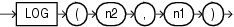

## LOG

Syntax



> ```
> LOG(n2, n1)
> ```
>
> [  
> Copyright © 1996, 2025, Oracle and/or its affiliates.](https://docs.oracle.com/en/database/oracle/oracle-database/dcommon/html/cpyr.htm)


Purpose

`LOG` returns the logarithm, base `n2`, of `n1`. The base `n2` can be any positive value other than 0 or 1 and `n1` can be any positive value.

This function takes as arguments any numeric data type or any nonnumeric data type that can be implicitly converted to a numeric data type. If any argument is `BINARY_FLOAT` or `BINARY_DOUBLE`, then the function returns `BINARY_DOUBLE`. Otherwise the function returns `NUMBER`.

See Also:

[Table 2-8](Data-Type-Comparison-Rules.md) for more information on implicit conversion

Examples

The following example returns the log of 100:

```
SELECT LOG(10,100) "Log base 10 of 100"
  FROM DUAL;

Log base 10 of 100
------------------
                 2
```