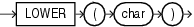

## LOWER

Syntax



> ```
> LOWER(char)
> ```
>
> [  
> Copyright © 1996, 2025, Oracle and/or its affiliates.](https://docs.oracle.com/en/database/oracle/oracle-database/dcommon/html/cpyr.htm)


Purpose

`LOWER` returns `char`, with all letters lowercase. `char` can be any of the data types `CHAR`, `VARCHAR2`, `NCHAR`, `NVARCHAR2`, `CLOB`, or `NCLOB`. The return value is the same data type as `char`. The database sets the case of the characters based on the binary mapping defined for the underlying character set. For linguistic-sensitive lowercase, refer to [NLS\_LOWER](NLS_LOWER.md).

See Also:

Appendix C in [Oracle Database Globalization Support Guide](https://docs.oracle.com/pls/topic/lookup?ctx=en/database/oracle/oracle-database/21/sqlrf&id=NLSPG-GUID-AFCE41ED-775B-4A00-AF38-C436776AE0C5) for the collation derivation rules, which define the collation assigned to the character return value of `LOWER`

Examples

The following example returns a string in lowercase:

```
SELECT LOWER('MR. SCOTT MCMILLAN') "Lowercase"
  FROM DUAL;

Lowercase
--------------------
mr. scott mcmillan
```