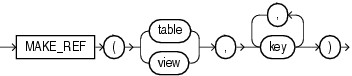

## MAKE\_REF

Syntax



> ```
> MAKE_REF({ table | view } , key [, key ]...)
> ```
>
> [  
> Copyright © 1996, 2025, Oracle and/or its affiliates.](https://docs.oracle.com/en/database/oracle/oracle-database/dcommon/html/cpyr.htm)


Purpose

`MAKE_REF` creates a `REF` to a row of an object view or a row in an object table whose object identifier is primary key based. This function is useful, for example, if you are creating an object view

See Also:

[Oracle Database Object-Relational Developer's Guide](https://docs.oracle.com/pls/topic/lookup?ctx=en/database/oracle/oracle-database/21/sqlrf&id=ADOBJ005) for more information about object views and [DEREF](DEREF.md)

Examples

The sample schema `oe` contains an object view `oc_inventories` based on `inventory_typ`. The object identifier is `product_id`. The following example creates a `REF` to the row in the `oc_inventories` object view with a `product_id` of 3003:

```
SELECT MAKE_REF (oc_inventories, 3003)
  FROM DUAL;

MAKE_REF(OC_INVENTORIES,3003)
------------------------------------------------------------------
00004A038A0046857C14617141109EE03408002082543600000014260100010001
00290090606002A00078401FE0000000B03C21F040000000000000000000000000
0000000000
```