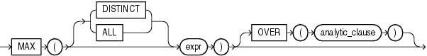

## MAX

Syntax



> ```
> MAX([ DISTINCT | ALL ] expr) [ OVER (analytic_clause) ]
> ```
>
> [  
> Copyright © 1996, 2025, Oracle and/or its affiliates.](https://docs.oracle.com/en/database/oracle/oracle-database/dcommon/html/cpyr.htm)


See Also:

" [Analytic Functions](Analytic-Functions.md) " for information on syntax, semantics, and restrictions

Purpose

`MAX` returns maximum value of `expr`. You can use it as an aggregate or analytic function.

See Also:

- " [About SQL Expressions](About-SQL-Expressions.md) " for information on valid forms of `expr`, " [Floating-Point Numbers](Data-Types.md) " for information on binary-float comparison semantics, and " [Aggregate Functions](Aggregate-Functions.md) "
- Appendix C in [Oracle Database Globalization Support Guide](https://docs.oracle.com/pls/topic/lookup?ctx=en/database/oracle/oracle-database/21/sqlrf&id=NLSPG-GUID-AFCE41ED-775B-4A00-AF38-C436776AE0C5) for the collation determination rules, which define the collation `MAX` uses to compare character values for `expr`, and for the collation derivation rules, which define the collation assigned to the return value of this function when it is a character value

Aggregate Example

The following example determines the highest salary in the `hr.employees` table:

```
SELECT MAX(salary) "Maximum"
  FROM employees;
 
   Maximum
----------
     24000
```

Analytic Examples

The following example calculates, for each employee, the highest salary of the employees reporting to the same manager as the employee.

```
SELECT manager_id, last_name, salary,
       MAX(salary) OVER (PARTITION BY manager_id) AS mgr_max
  FROM employees
  ORDER BY manager_id, last_name, salary;

MANAGER_ID LAST_NAME                     SALARY    MGR_MAX
---------- ------------------------- ---------- ----------
       100 Cambrault                      11000      17000
       100 De Haan                        17000      17000
       100 Errazuriz                      12000      17000
       100 Fripp                           8200      17000
       100 Hartstein                      13000      17000
       100 Kaufling                        7900      17000
       100 Kochhar                        17000      17000
. . .
```

If you enclose this query in the parent query with a predicate, then you can determine the employee who makes the highest salary in each department:

```
SELECT manager_id, last_name, salary
  FROM (SELECT manager_id, last_name, salary, 
               MAX(salary) OVER (PARTITION BY manager_id) AS rmax_sal
          FROM employees)
  WHERE salary = rmax_sal
  ORDER BY manager_id, last_name, salary;

MANAGER_ID LAST_NAME                     SALARY
---------- ------------------------- ----------
       100 De Haan                        17000
       100 Kochhar                        17000
       101 Greenberg                      12008
       101 Higgins                        12008
       102 Hunold                          9000
       103 Ernst                           6000
       108 Faviet                          9000
       114 Khoo                            3100
       120 Nayer                           3200
       120 Taylor                          3200
       121 Sarchand                        4200
       122 Chung                           3800
       123 Bell                            4000
       124 Rajs                            3500
       145 Tucker                         10000
       146 King                           10000
       147 Vishney                        10500
       148 Ozer                           11500
       149 Abel                           11000
       201 Fay                             6000
       205 Gietz                           8300
           King                           24000
 
22 rows selected.
```