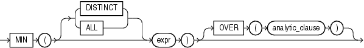

## MIN

Syntax



> ```
> MIN([ DISTINCT | ALL ] expr) [ OVER (analytic_clause) ]
> ```
>
> [  
> Copyright © 1996, 2025, Oracle and/or its affiliates.](https://docs.oracle.com/en/database/oracle/oracle-database/dcommon/html/cpyr.htm)


See Also:

" [Analytic Functions](Analytic-Functions.md) " for information on syntax, semantics, and restrictions

Purpose

`MIN` returns minimum value of `expr`. You can use it as an aggregate or analytic function.

See Also:

- " [About SQL Expressions](About-SQL-Expressions.md) " for information on valid forms of `expr`, " [Floating-Point Numbers](Data-Types.md) " for information on binary-float comparison semantics, and " [Aggregate Functions](Aggregate-Functions.md) "
- Appendix C in [Oracle Database Globalization Support Guide](https://docs.oracle.com/pls/topic/lookup?ctx=en/database/oracle/oracle-database/21/sqlrf&id=NLSPG-GUID-AFCE41ED-775B-4A00-AF38-C436776AE0C5) for the collation determination rules, which define the collation `MIN` uses to compare character values for `expr`, and for the collation derivation rules, which define the collation assigned to the return value of this function when it is a character value

Aggregate Example

The following statement returns the earliest hire date in the `hr.employees` table:

```
SELECT MIN(hire_date) "Earliest"
  FROM employees;
 
Earliest
---------
13-JAN-01
```

Analytic Example

The following example determines, for each employee, the employees who were hired on or before the same date as the employee. It then determines the subset of employees reporting to the same manager as the employee, and returns the lowest salary in that subset.

```
SELECT manager_id, last_name, hire_date, salary,
       MIN(salary) OVER(PARTITION BY manager_id ORDER BY hire_date
         RANGE UNBOUNDED PRECEDING) AS p_cmin
  FROM employees
  ORDER BY manager_id, last_name, hire_date, salary;

MANAGER_ID LAST_NAME                 HIRE_DATE     SALARY     P_CMIN
---------- ------------------------- --------- ---------- ----------
       100 Cambrault                 15-OCT-07      11000       6500
       100 De Haan                   13-JAN-01      17000      17000
       100 Errazuriz                 10-MAR-05      12000       7900
       100 Fripp                     10-APR-05       8200       7900
       100 Hartstein                 17-FEB-04      13000       7900
       100 Kaufling                  01-MAY-03       7900       7900
       100 Kochhar                   21-SEP-05      17000       7900
       100 Mourgos                   16-NOV-07       5800       5800
       100 Partners                  05-JAN-05      13500       7900
       100 Raphaely                  07-DEC-02      11000      11000
       100 Russell                   01-OCT-04      14000       7900

. . .
```