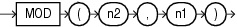

## MOD

Syntax



> ```
> MOD(n2, n1)
> ```
>
> [  
> Copyright © 1996, 2025, Oracle and/or its affiliates.](https://docs.oracle.com/en/database/oracle/oracle-database/dcommon/html/cpyr.htm)


Purpose

`MOD` returns the remainder of `n2` divided by `n1`. Returns `n2` if `n1` is 0.

This function takes as arguments any numeric data type or any nonnumeric data type that can be implicitly converted to a numeric data type. Oracle determines the argument with the highest numeric precedence, implicitly converts the remaining arguments to that data type, and returns that data type.

See Also:

[Table 2-8](Data-Type-Comparison-Rules.md) for more information on implicit conversion and " [Numeric Precedence](Data-Types.md) " for information on numeric precedence

Examples

The following example returns the remainder of 11 divided by 4:

```
SELECT MOD(11,4) "Modulus"
  FROM DUAL;

   Modulus
----------
         3
```

This function behaves differently from the classical mathematical modulus function, if the product of `n1` and `n2` is negative. The classical modulus can be expressed using the `MOD` function with this formula:

```
n2 - n1 * FLOOR(n2/n1)
```

The following table illustrates the difference between the `MOD` function and the classical modulus:

| n2 | n1 | MOD(n2,n1) | Classical Modulus |
| --- | --- | --- | --- |
| `11` | `4` | `3` | `3` |
| `11` | `-4` | `3` | `-1` |
| `-11` | `4` | `-3` | `1` |
| `-11` | `-4` | `-3` | `-3` |

See Also:

[FLOOR](FLOOR.md) and [REMAINDER](REMAINDER.md), which is similar to `MOD`, but uses `ROUND` in its formula instead of `FLOOR`