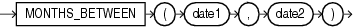

## MONTHS\_BETWEEN

Syntax



> ```
> MONTHS_BETWEEN(date1, date2)
> ```
>
> [  
> Copyright © 1996, 2025, Oracle and/or its affiliates.](https://docs.oracle.com/en/database/oracle/oracle-database/dcommon/html/cpyr.htm)


Purpose

`MONTHS_BETWEEN` returns number of months between dates `date1` and `date2`. The month and the last day of the month are defined by the parameter `NLS_CALENDAR`. If `date1` is later than `date2`, then the result is positive. If `date1` is earlier than `date2`, then the result is negative. If `date1` and `date2` are either the same days of the month or both last days of months, then the result is always an integer. Otherwise Oracle Database calculates the fractional portion of the result based on a 31-day month and considers the difference in time components `date1` and `date2`.

Examples

The following example calculates the months between two dates:

```
SELECT MONTHS_BETWEEN
       (TO_DATE('02-02-1995','MM-DD-YYYY'),
        TO_DATE('01-01-1995','MM-DD-YYYY') ) "Months"
  FROM DUAL;

    Months
----------
1.03225806
```