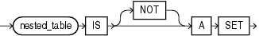
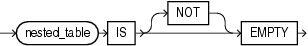
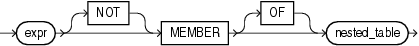
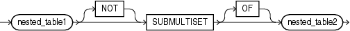

## Multiset Conditions

Multiset conditions test various aspects of nested tables.

### IS A SET Condition

Use `IS` `A` `SET` conditions to test whether a specified nested table is composed of unique elements. The condition returns `UNKNOWN` if the nested table is `NULL`. Otherwise, it returns `TRUE` if the nested table is a set, even if it is a nested table of length zero, and `FALSE` otherwise.

is\_a\_set\_condition::=



> ```
> nested_table IS [ NOT ] A SET
> ```
>
> [  
> Copyright © 1996, 2025, Oracle and/or its affiliates.](https://docs.oracle.com/en/database/oracle/oracle-database/dcommon/html/cpyr.htm)


Example

The following example selects from the table `customers_demo` those rows in which the `cust_address_ntab` nested table column contains unique elements:

```
SELECT customer_id, cust_address_ntab
  FROM customers_demo
  WHERE cust_address_ntab IS A SET
  ORDER BY customer_id;

CUSTOMER_ID CUST_ADDRESS_NTAB(STREET_ADDRESS, POSTAL_CODE, CITY, STATE_PROVINCE, COUNTRY_ID)
----------------------------------------------------------------------------------------------
        101 CUST_ADDRESS_TAB_TYP(CUST_ADDRESS_TYP('514 W Superior St', '46901', 'Kokomo', 'IN', 'US'))
        102 CUST_ADDRESS_TAB_TYP(CUST_ADDRESS_TYP('2515 Bloyd Ave', '46218', 'Indianapolis', 'IN', 'US'))
        103 CUST_ADDRESS_TAB_TYP(CUST_ADDRESS_TYP('8768 N State Rd 37', '47404', 'Bloomington', 'IN', 'US'))
        104 CUST_ADDRESS_TAB_TYP(CUST_ADDRESS_TYP('6445 Bay Harbor Ln', '46254', 'Indianapolis', 'IN', 'US'))
        105 CUST_ADDRESS_TAB_TYP(CUST_ADDRESS_TYP('4019 W 3Rd St', '47404', 'Bloomington', 'IN', 'US'))
```

The preceding example requires the table `customers_demo` and a nested table column containing data. Refer to " [Multiset Operators](Multiset-Operators.md) " to create this table and nested table column.

### IS EMPTY Condition

Use the `IS` `[NOT]` `EMPTY` conditions to test whether a specified nested table is empty. A nested table that consists of a single value, a `NULL`, is not considered an empty nested table.

is\_empty\_condition::=



> ```
> nested_table IS [ NOT ] EMPTY
> ```
>
> [  
> Copyright © 1996, 2025, Oracle and/or its affiliates.](https://docs.oracle.com/en/database/oracle/oracle-database/dcommon/html/cpyr.htm)


The condition returns a Boolean value: `TRUE` for an `IS` `EMPTY` condition if the collection is empty, and `TRUE` for an `IS` `NOT` `EMPTY` condition if the collection is not empty. If you specify `NULL` for the nested table or varray, then the result is `NULL`.

Example

The following example selects from the sample table `pm.print_media` those rows in which the `ad_textdocs_ntab` nested table column is not empty:

```
SELECT product_id, TO_CHAR(ad_finaltext) AS text
   FROM print_media
   WHERE ad_textdocs_ntab IS NOT EMPTY 
   ORDER BY product_id, text;
```

### MEMBER Condition

member\_condition::=



> ```
> expr [ NOT ] MEMBER [ OF ] nested_table
> ```
>
> [  
> Copyright © 1996, 2025, Oracle and/or its affiliates.](https://docs.oracle.com/en/database/oracle/oracle-database/dcommon/html/cpyr.htm)


A `member_condition` is a membership condition that tests whether an element is a member of a nested table. The return value is `TRUE` if `expr` is equal to a member of the specified nested table or varray. The return value is `NULL` if `expr` is null or if the nested table is empty.

- `expr` must be of the same type as the element type of the nested table.
- The `OF` keyword is optional and does not change the behavior of the condition.
- The `NOT` keyword reverses the Boolean output: Oracle returns `FALSE` if `expr` is a member of the specified nested table.
- The element types of the nested table must be comparable. Refer to [Comparison Conditions](Comparison-Conditions.md) for information on the comparability of nonscalar types.

Example

The following example selects from the table `customers_demo` those rows in which the `cust_address_ntab` nested table column contains the values specified in the `WHERE` clause:

```
SELECT customer_id, cust_address_ntab
  FROM customers_demo
  WHERE cust_address_typ('8768 N State Rd 37', 47404, 
                         'Bloomington', 'IN', 'US')
  MEMBER OF cust_address_ntab
  ORDER BY customer_id;

CUSTOMER_ID CUST_ADDRESS_NTAB(STREET_ADDRESS, POSTAL_CODE, CITY, STATE_PROVINCE, COUNTRY_ID)
------------ ---------------------------------------------------------------------------------
        103 CUST_ADDRESS_TAB_TYP(CUST_ADDRESS_TYP('8768 N State Rd 37', '47404', 'Bloomington', 'IN', 'US'))
```

The preceding example requires the table `customers_demo` and a nested table column containing data. Refer to [Multiset Operators](Multiset-Operators.md) to create this table and nested table column.

### SUBMULTISET Condition

The `SUBMULTISET` condition tests whether a specified nested table is a submultiset of another specified nested table.

The operator returns a Boolean value. `TRUE` is returned when `nested_table1` is a submultiset of `nested_table2`. `nested_table1` is a submultiset of `nested_table2` when one of the following conditions occur:

- `nested_table1` is not null and contains no rows. `TRUE` is returned even if `nested_table2` is null since an empty multiset is a submultiset of any non-null replacement for `nested_table2`.
- `nested_table1` and `nested_table2` are not null, `nested_table1` does not contain a null element, and there is a one-to-one mapping of each element in `nested_table1` to an equal element in `nested_table2`.

`NULL` is returned when one of the following conditions occurs:

- `nested_table1` is null.
- `nested_table2` is null, and `nested_table1` is not null and not empty.
- `nested_table1` is a submultiset of `nested_table2` after modifying each null element of `nested_table1` and `nested_table2` to some non-null value, enabling a one-to-one mapping of each element in `nested_table1` to an equal element in `nested_table2`.

If none of the above conditions occur, then `FALSE` is returned.

submultiset\_condition::=



> ```
> nested_table1
> [ NOT ] SUBMULTISET [ OF ]
> nested_table2
> ```
>
> [  
> Copyright © 1996, 2025, Oracle and/or its affiliates.](https://docs.oracle.com/en/database/oracle/oracle-database/dcommon/html/cpyr.htm)


- The `OF` keyword is optional and does not change the behavior of the operator.
- The `NOT` keyword reverses the Boolean output: Oracle returns `FALSE` if `nested_table1` is a subset of `nested_table2`.
- The element types of the nested table must be comparable. Refer to [Comparison Conditions](Comparison-Conditions.md) for information on the comparability of nonscalar types.

Example

The following example selects from the `customers_demo` table those rows in which the `cust_address_ntab` nested table is a submultiset of the `cust_address2_ntab` nested table:

```
SELECT customer_id, cust_address_ntab
  FROM customers_demo
  WHERE cust_address_ntab SUBMULTISET OF cust_address2_ntab
  ORDER BY customer_id;
```

The preceding example requires the table `customers_demo` and two nested table columns containing data. Refer to [Multiset Operators](Multiset-Operators.md) to create this table and nested table columns.