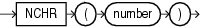

## NCHR

Syntax



> ```
> NCHR(number)
> ```
>
> [  
> Copyright © 1996, 2025, Oracle and/or its affiliates.](https://docs.oracle.com/en/database/oracle/oracle-database/dcommon/html/cpyr.htm)


Purpose

`NCHR` returns the character having the binary equivalent to `number` in the national character set. The value returned is always `NVARCHAR2`. This function is equivalent to using the `CHR` function with the `USING` `NCHAR_CS` clause.

This function takes as an argument a `NUMBER` value, or any value that can be implicitly converted to `NUMBER`, and returns a character.

See Also:

- [CHR](CHR.md)
- Appendix C in [Oracle Database Globalization Support Guide](https://docs.oracle.com/pls/topic/lookup?ctx=en/database/oracle/oracle-database/21/sqlrf&id=NLSPG-GUID-AFCE41ED-775B-4A00-AF38-C436776AE0C5) for the collation derivation rules, which define the collation assigned to the character return value of `NCHR`

Examples

The following examples return the nchar character 187:

```
SELECT NCHR(187)
  FROM DUAL;

N
-
> 

SELECT CHR(187 USING NCHAR_CS)
  FROM DUAL;

C
-
>
```