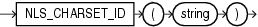

## NLS\_CHARSET\_ID

Syntax



> ```
> NLS_CHARSET_ID(string)
> ```
>
> [  
> Copyright © 1996, 2025, Oracle and/or its affiliates.](https://docs.oracle.com/en/database/oracle/oracle-database/dcommon/html/cpyr.htm)


Purpose

`NLS_CHARSET_ID` returns the character set ID number corresponding to character set name `string`. The `string` argument is a run-time `VARCHAR2` value. The `string` value ' `CHAR_CS` ' returns the database character set ID number of the server. The `string` value ' `NCHAR_CS` ' returns the national character set ID number of the server.

Invalid character set names return null.

See Also:

[Oracle Database Globalization Support Guide](https://docs.oracle.com/pls/topic/lookup?ctx=en/database/oracle/oracle-database/21/sqlrf&id=NLSPG584) for a list of character sets

Examples

The following example returns the character set ID of a character set:

```
SELECT NLS_CHARSET_ID('ja16euc') 
  FROM DUAL; 

NLS_CHARSET_ID('JA16EUC')
------------------------- 
                      830
```