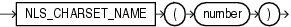

## NLS\_CHARSET\_NAME

Syntax



> ```
> NLS_CHARSET_NAME(number)
> ```
>
> [  
> Copyright © 1996, 2025, Oracle and/or its affiliates.](https://docs.oracle.com/en/database/oracle/oracle-database/dcommon/html/cpyr.htm)


Purpose

`NLS_CHARSET_NAME` returns the name of the character set corresponding to ID number `number`. The character set name is returned as a `VARCHAR2` value in the database character set. If `number` is not recognized as a valid character set ID, then this function returns null.

This function returns a `VARCHAR2` value.

Examples

The following example returns the character set corresponding to character set ID number 2:

```
SELECT NLS_CHARSET_NAME(2)
  FROM DUAL;

NLS_CH 
------ 
WE8DEC
```