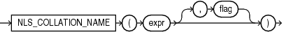

## NLS\_COLLATION\_NAME

Syntax



> ```
> NLS_COLLATION_NAME(expr [, flag ])
> ```
>
> [  
> Copyright © 1996, 2025, Oracle and/or its affiliates.](https://docs.oracle.com/en/database/oracle/oracle-database/dcommon/html/cpyr.htm)


Purpose

`NLS_COLLATION_NAME` takes as its argument a collation ID number and returns the corresponding collation name. Collation IDs are used in the data dictionary tables and in Oracle Call Interface (OCI). Collation names are used in SQL statements and data dictionary views

For `expr`, specify the collation ID as a `NUMBER` value.

This function returns a `VARCHAR2` value. If you specify an invalid collation ID, then this function returns null.

The optional `flag` parameter applies only to Unicode Collation Algorithm (UCA) collations. This parameter determines whether the function returns the short form or long form of the collation name. The parameter must be a character expression evaluating to the value `'S'`, `'s'`, `'L'`, or `'l'`, with the following meaning:

- `'S'` or `'s'` – Returns the short form of the collation name
- `'L'` or `'l'` – Returns the long form of the collation name

If you omit `flag`, then the default is `'L'`.

See Also:

- [Oracle Database Globalization Support Guide](https://docs.oracle.com/pls/topic/lookup?ctx=en/database/oracle/oracle-database/21/sqlrf&id=NLSPG1005) for more information on UCA collations
- Appendix C in [Oracle Database Globalization Support Guide](https://docs.oracle.com/pls/topic/lookup?ctx=en/database/oracle/oracle-database/21/sqlrf&id=NLSPG-GUID-AFCE41ED-775B-4A00-AF38-C436776AE0C5) for the collation derivation rules, which define the collation assigned to the character return value of `NLS_COLLATION_NAME`

Examples

The following example returns the name of the collation corresponding to collation ID number 81919:

```
SELECT NLS_COLLATION_NAME(81919)
  FROM DUAL;

NLS_COLLA
---------
BINARY_AI
```

The following example returns the short form of the name of the UCA collation corresponding to collation ID number 208897:

```
SELECT NLS_COLLATION_NAME(208897,'S')
  FROM DUAL;

NLS_COLLATION
-------------
UCA0610_DUCET
```

The following example returns the long form of the name of the UCA collation corresponding to collation ID number 208897:

```
SELECT NLS_COLLATION_NAME(208897,'L')
  FROM DUAL;

NLS_COLLATION_NAME(208897,'L')
----------------------------------------
UCA0610_DUCET_S4_VS_BN_NY_EN_FN_HN_DN_MN
```