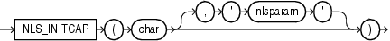

## NLS\_INITCAP

Syntax



> ```
> NLS_INITCAP(char [, 'nlsparam' ])
> ```
>
> [  
> Copyright © 1996, 2025, Oracle and/or its affiliates.](https://docs.oracle.com/en/database/oracle/oracle-database/dcommon/html/cpyr.htm)


Purpose

`NLS_INITCAP` returns `char`, with the first letter of each word in uppercase, all other letters in lowercase. Words are delimited by white space or characters that are not alphanumeric.

Both `char` and `'nlsparam'` can be any of the data types `CHAR`, `VARCHAR2`, `NCHAR`, or `NVARCHAR2`. The string returned is of `VARCHAR2` data type and is in the same character set as `char`.

The value of `'nlsparam'` can have this form:

```
'NLS_SORT = sort'
```

where `sort` is a named collation. The collation handles special linguistic requirements for case conversions. These requirements can result in a return value of a different length than the `char`. If you omit `'nlsparam'`, then this function uses the determined collation of the function.

This function does not support `CLOB` data directly. However, `CLOB` s can be passed in as arguments through implicit data conversion.

See Also:

- " [Data Type Comparison Rules](Data-Type-Comparison-Rules.md) " for more information.
- Appendix C in [Oracle Database Globalization Support Guide](https://docs.oracle.com/pls/topic/lookup?ctx=en/database/oracle/oracle-database/21/sqlrf&id=NLSPG-GUID-AFCE41ED-775B-4A00-AF38-C436776AE0C5) for the collation determination rules for `NLS_INITCAP`, and for the collation derivation rules, which define the collation assigned to the character return value of this function

Examples

The following examples show how the linguistic sort sequence results in a different return value from the function:

```
SELECT NLS_INITCAP('ijsland') "InitCap"
  FROM DUAL;

InitCap
-------
Ijsland

SELECT NLS_INITCAP('ijsland', 'NLS_SORT = XDutch') "InitCap"
  FROM DUAL;

InitCap
-------
IJsland
```

See Also:

[Oracle Database Globalization Support Guide](https://docs.oracle.com/pls/topic/lookup?ctx=en/database/oracle/oracle-database/21/sqlrf&id=NLSPG005) for information on collations